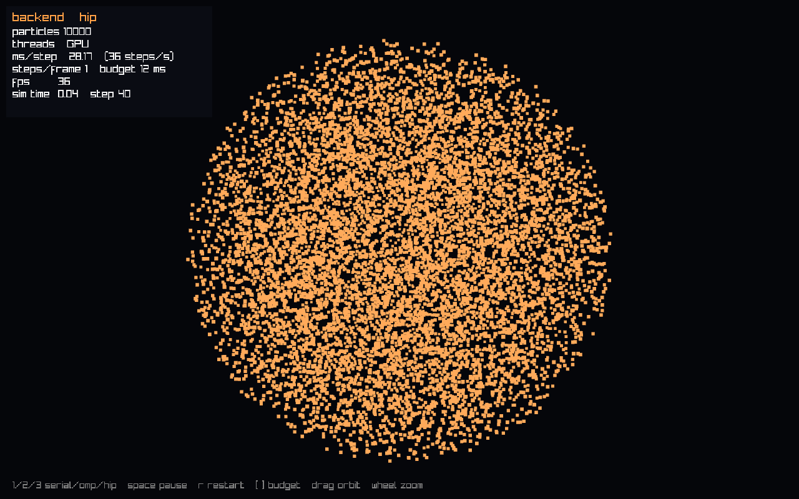
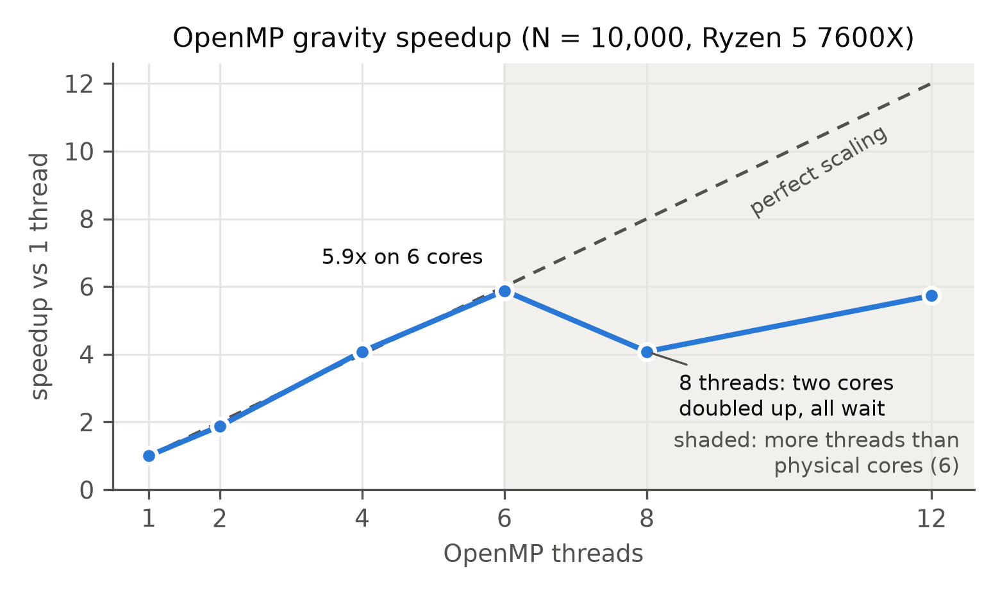

# Planet Collision Simulator

[](https://github.com/pearcepackman/CMSC483-Collision-Simulation/actions/workflows/ci.yml)

Smash two particle-based planets together and use parallel computing to make an O(N²) physics problem fast enough to watch. CMSC 483 (Parallel Computing) project, Fall 2026.

Each planet is a ball of thousands of particles. Every timestep, every particle pulls on every other one (gravity), overlapping particles push apart and lose energy (soft-sphere contact), and a leapfrog integrator advances positions and velocities. The same simulation runs on three swappable backends, **serial**, **OpenMP** (CPU threads) and **HIP** (AMD GPU), so we can measure exactly how much each one speeds things up.



## Results so far

Gravity for 10,000 particles, one step, measured in the live viewer (Ryzen 5 7600X, Radeon RX 9060 XT):

| Backend | ms per step | Speedup over serial |
|---|---|---|
| Serial | 277 | 1x |
| OpenMP, 12 threads | 47 | 5.9x |
| GPU, first kernel (double precision) | 28 | 9.9x |

OpenMP scales almost perfectly up to the 6 physical cores:



The GPU kernel is still the simple version. This card runs double precision about 13 times slower than single, and timing the kernel alone in single precision gave 2 ms per step at this size, so the float and tiled kernels (#32, #26) should widen the gap a lot. The full history, with screenshots, is in [docs/progress.md](docs/progress.md).

## Status

| # | Milestone | Status |
|---|---|---|
| 0 | Repo, build system, CI | Done |
| 1 | Serial two-body orbit (leapfrog, energy conservation) | In progress: gravity + leapfrog done; planet generation, frame output, rendering left |
| 2 | Serial planet collision + first video | In progress: `planet_sim` loop and CLI done; planets, contact, config, relaxation, video left |
| 3 | OpenMP backend + speedup graphs | In progress: OpenMP gravity ~6x faster on 6 cores |
| 4 | GPU backend (HIP on AMD) | In progress: HIP build + CI compile check, naive double-precision GPU gravity done; tiled kernel left |
| 5 | Grid-based contact, impact scenarios, full benchmarks | Not started |
| V | Live viewer (`planet_view`) | In progress: 3D window with live serial/OpenMP/GPU switching done; glow look and replay/video export left |
| 6 | Stretch goals (Barnes-Hut, atomics comparison) + presentation | Not started |

Full plan: [PLAN.md](PLAN.md).

## Quickstart

**Requirements:** CMake ≥ 3.25, Ninja, a C++17 compiler with OpenMP, Python 3 (for the formatter). ROCm/HIP optional (only for the GPU backend, needs a supported AMD GPU).

```bash
# Ubuntu / Debian (primary platform)
sudo apt install build-essential cmake ninja-build clang libomp-dev python3-venv

# macOS (secondary: no GPU backend, no ThreadSanitizer, no AddressSanitizer on current Apple clang)
brew install cmake ninja libomp
```

Build, test, run:

```bash
cmake --preset dev && cmake --build --preset dev
ctest --preset dev
./build/dev/planet_sim --scenario figure8 --steps 20000
```

GoogleTest downloads automatically during the first configure.

`planet_sim` usage (`--help` for all flags):

```bash
planet_sim --scenario orbit|figure8|cloud [--n N] [--seed S]   # built-in setups, no files needed
planet_sim --config configs/head_on.cfg --out frames/run       # planets from a scenario file
           [--backend serial|omp|hip] [--steps N] [--dt h] [--output-every k]
planet_sim --scenario cloud --n 10000 --backend omp --bench    # one "bench ..." timing line
```

`--out` writes `frame_NNNNN.csv` files and `energy.csv` (`step,t,kinetic,potential,total,px,py,pz`). Exit codes: 0 ok, 1 usage/setup error, 2 the simulation produced NaN/Inf. `--config` and frame output need #13 and #10.

Measure the OpenMP speedup (release build, threads pinned to cores):

```bash
cmake --preset release && cmake --build --preset release
OMP_PROC_BIND=close OMP_PLACES=cores ./build/release/bench_gravity 10000
```

Run on the GPU (needs ROCm and a supported AMD GPU; setup in [docs/tooling.md](docs/tooling.md)):

```bash
cmake --preset hip && cmake --build --preset hip
ctest --preset hip                                   # includes the gpu-labelled tests
./build/hip/planet_sim --scenario cloud --n 30000 --steps 10 --backend hip --bench
```

Watch it live: `planet_view` opens a 3D window running the same simulation. Press **1 / 2 / 3** to switch serial / OpenMP / GPU mid-run and watch ms/step and fps change (needs X11/OpenGL; raylib downloads automatically):

```bash
cmake --preset demo && cmake --build --preset demo      # Release + GPU + viewer (no GPU? use the viewer preset)
./build/demo/planet_view --scenario cloud --n 10000 --backend omp
```

Keys: `1/2/3` backend, `space` pause, `r` restart, `[ ]` step time budget per frame (how long each frame simulates before drawing), drag to orbit, mouse wheel to zoom. `--frames N --screenshot out.png` runs N frames and saves the last one. Exit codes match `planet_sim`: 0 ok, 1 usage/setup error, 2 the simulation produced NaN/Inf.

### Build presets

| Preset | Use it for |
|---|---|
| `dev` | Day-to-day work: optimized with debug info, warnings are errors |
| `release` | Benchmarks: `-O3 -march=native` |
| `asan` | Finding memory bugs and undefined behaviour (AddressSanitizer + UBSan, Linux) |
| `tsan` | Finding data races in parallel code (ThreadSanitizer, Linux) |
| `hip` | The GPU backend (`--backend hip`): ROCm, built for the RX 9060 XT (`gfx1200`) and the Ryzen's integrated GPU (`gfx1036`) |
| `viewer` | `dev` + the live viewer `planet_view` (raylib, X11/OpenGL) |
| `demo` | The presentation build: Release, `-march=native`, GPU backend + viewer |

Each preset builds into its own `build/<preset>/` folder. Run `cmake --preset <name> && cmake --build --preset <name> && ctest --preset <name>`.

### Formatting

Code is formatted with a pinned clang-format so local runs and CI always agree:

```bash
python3 -m venv .venv && .venv/bin/pip install -r requirements-dev.txt
git ls-files '*.cpp' '*.hpp' '*.hip' | xargs .venv/bin/clang-format -i
```

## Repository layout

```
src/        simulator source (particles, physics, backends, CLI)
viewer/     planet_view, the live 3D window (raylib)
tests/      GoogleTest suites: physics correctness and backend agreement
docs/       progress log with screenshots, design notes, tooling decisions, kickstart guide
scripts/    rendering, plotting and benchmark scripts (Python)        [coming]
configs/    impact scenarios (head-on, grazing, Theia-like)           [coming]
bench/      micro-benchmarks (bench_gravity) and committed results
```

## How we know it's correct

Parallel physics code can look fine while being wrong, so every pull request has to pass CI before it can merge:

- Physics tests: orbits stay closed, energy and momentum are conserved, nothing becomes NaN.
- OpenMP forces match the serial reference within a floating-point tolerance, tested at 1 and 4 threads.
- AddressSanitizer and UBSan for memory bugs, ThreadSanitizer for data races.
- Builds with gcc and clang with warnings as errors, plus a HIP compile check and a run of the live viewer on a virtual screen.

CI machines have no GPU, so the GPU tests (which compare HIP against serial the same way) run on our own machine with `ctest --preset hip`.

Details: [docs/tooling.md](docs/tooling.md). Design decisions and benchmark findings: [docs/notes.md](docs/notes.md).

## Team

- Pearce Packman
- Kyle ([@kpoudyal06](https://github.com/kpoudyal06))
