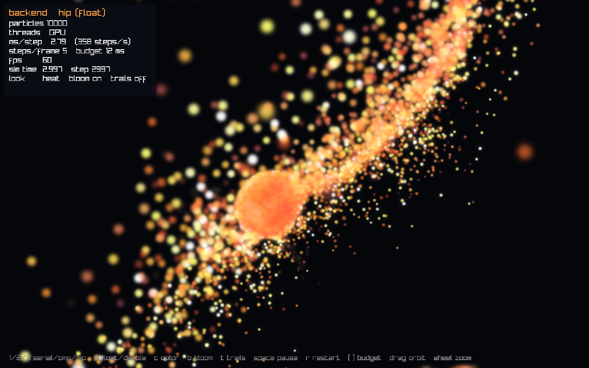
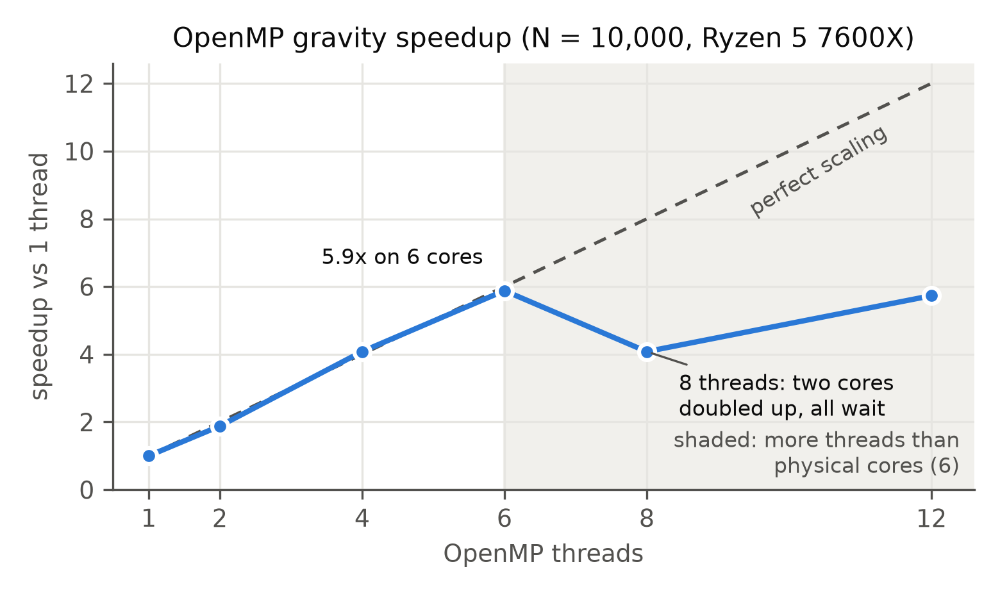

# Planet Collision Simulator

[](https://github.com/pearcepackman/CMSC483-Collision-Simulation/actions/workflows/ci.yml)

Smash two particle-based planets together and use parallel computing to make an O(N²) physics problem fast enough to watch. CMSC 483 (Parallel Computing) project, Fall 2026.

Each planet is a ball of thousands of particles. Every timestep, every particle pulls on every other one (gravity), overlapping particles push apart and lose energy (soft-sphere contact), and a leapfrog integrator advances positions and velocities. The same simulation runs on three swappable backends, **serial**, **OpenMP** (CPU threads) and **HIP** (AMD GPU), so we can measure exactly how much each one speeds things up.



## Results so far

One simulation step (all forces plus the integrator), `planet_sim --bench` on a Ryzen 5 7600X and a Radeon RX 9060 XT, in milliseconds:

| | Serial | OpenMP, 6 threads | GPU (float) | GPU vs serial | GPU vs OpenMP |
|---|---|---|---|---|---|
| Head-on collision, 4,000 particles | 52.5 | 10.3 | 1.1 | 48x | 9.4x |
| Cloud, 10,000 particles | 287 | 52.7 | 2.1 | 137x | 25x |
| Cloud, 50,000 particles | 7,198 | 1,271 | 29 | 248x | 44x |

OpenMP scales almost perfectly up to the 6 physical cores:



The GPU computes gravity, contact and heat in one kernel in single precision (`--gpu-precision double` gives the exact reference). Single precision is what makes it fast: this card runs double about 13 times slower. The full history, with screenshots, is in [docs/progress.md](docs/progress.md).

## Status

The first plan ran in milestones M0 to M6 plus the viewer. On Nov 20 we re-planned the last three weeks around what the project has to show: real speedups, a simulation that looks like the giant-impact studies, and the talk.

| Milestone | Status |
|---|---|
| M0 to M2: build, CI, serial physics, first collision | Done: gravity, leapfrog, planets with relaxation, soft-sphere contact with heat, scenario files, frame output and video, an energy log that counts every term, conservation tests and a CI smoke collision |
| Parallel backends so far | Done: OpenMP gravity (~6x on 6 cores), grid contact (33x faster than all pairs at 32k particles), a first GPU kernel, and the live viewer with serial/OpenMP/GPU switching |
| F1: Fast + measured (Nov 27) | In progress: float + tiled GPU kernel with contact in the kernel, parallel contact, benchmark harness |
| F2: Showpiece (Dec 6) | Not started: layered planets, Theia-style impact colored by heat and material, Barnes-Hut tree gravity, impact analysis, scaling plots, hero video |
| F3: Presentation (Dec 10) | Not started: slides, final README and demo video, Q&A rehearsal |

Full plan: [PLAN.md](PLAN.md).

## Quickstart

**Requirements:** CMake ≥ 3.25, Ninja, a C++17 compiler with OpenMP, Python 3 (for the formatter). ROCm/HIP optional (only for the GPU backend, needs a supported AMD GPU).

```bash
# Ubuntu / Debian (primary platform)
sudo apt install build-essential cmake ninja-build clang libomp-dev python3-venv

# macOS (secondary: no GPU backend, no ThreadSanitizer, no AddressSanitizer on current Apple clang)
brew install cmake ninja libomp
```

Build, test, run:

```bash
cmake --preset dev && cmake --build --preset dev
ctest --preset dev
./build/dev/planet_sim --scenario figure8 --steps 20000
```

GoogleTest downloads automatically during the first configure.

`planet_sim` usage (`--help` for all flags):

```bash
planet_sim --scenario orbit|figure8|cloud [--n N] [--seed S]   # built-in setups, no files needed
planet_sim --config configs/head_on.cfg --out frames/run       # planets from a scenario file
           [--backend serial|omp|hip] [--steps N] [--dt h] [--output-every k]
planet_sim --scenario cloud --n 10000 --backend omp --bench    # one "bench ..." timing line
```

`--out` writes `frame_NNNNN.csv` files (`id,x,y,z,vx,vy,vz,mass,body,material,heat`, one row per particle) and `energy.csv` (`step,t,kinetic,potential,contact,heat,total,px,py,pz`, where `contact` is the energy held in compressed contact springs, `heat` is the energy contact damping has turned into heat, and `total` = kinetic + potential + contact + heat). Exit codes: 0 ok, 1 usage/setup error (including a bad config file), 2 the simulation produced NaN/Inf. Scenario files are `key = value` text; see [configs/head_on.cfg](configs/head_on.cfg) for every key.

Turn a run's frames into a video (a quick-look debug tool, colored by planet; ffmpeg comes with the pip packages):

```bash
python3 -m venv .venv && .venv/bin/pip install -r scripts/requirements.txt
./build/dev/planet_sim --scenario cloud --n 2000 --steps 400 --output-every 10 --out frames/cloud
.venv/bin/python scripts/render.py frames/cloud -o cloud.mp4 [--fps 30] [--every k] [--still last.png]
```

Plot a run's energy log (kinetic, potential, heat, total, and the change in the total). It also prints the largest rise of the total; `--max-rise X` exits 3 if that rise is above X. The log leaves out energy stored in compressed contact springs, so a collision can show a small rise that isn't real:

```bash
./build/dev/planet_sim --config configs/head_on.cfg --out frames/head_on
.venv/bin/python scripts/plot_energy.py frames/head_on/energy.csv -o energy.png [--title T] [--max-rise X]
```

Measure the OpenMP speedup (release build, threads pinned to cores):

```bash
cmake --preset release && cmake --build --preset release
OMP_PROC_BIND=close OMP_PLACES=cores ./build/release/bench_gravity 10000
```

Compare all-pairs contact with the grid (one thread, planets of 1k to 32k particles; exits 1 if the two disagree):

```bash
./build/release/bench_contact 32000
```

Run on the GPU (needs ROCm and a supported AMD GPU; setup in [docs/tooling.md](docs/tooling.md)):

```bash
cmake --preset hip && cmake --build --preset hip
ctest --preset hip                                   # includes the gpu-labelled tests
./build/hip/planet_sim --scenario cloud --n 30000 --steps 10 --backend hip --bench
```

Watch it live: `planet_view` opens a 3D window running the same simulation. Press **1 / 2 / 3** to switch serial / OpenMP / GPU mid-run and watch ms/step and fps change (needs X11/OpenGL; raylib downloads automatically):

```bash
cmake --preset demo && cmake --build --preset demo      # Release + GPU + viewer (no GPU? use the viewer preset)
./build/demo/planet_view --config configs/smash.cfg --backend hip   # the destruction run
./build/demo/planet_view --scenario cloud --n 10000 --backend omp
```

Keys: `1/2/3` backend, `p` GPU float/double, `c` color (heat, material, planet, speed, plain), `b` bloom, `t` trails, `space` pause, `r` restart, `[ ]` step time budget per frame (how long each frame simulates before drawing), drag to orbit, mouse wheel to zoom. `--frames N --screenshot out.png` runs N frames and saves the last one; `--color MODE`, `--no-bloom` and `--trails` set the look at start. Exit codes match `planet_sim`: 0 ok, 1 usage/setup error, 2 the simulation produced NaN/Inf.

### Build presets

| Preset | Use it for |
|---|---|
| `dev` | Day-to-day work: optimized with debug info, warnings are errors |
| `release` | Benchmarks: `-O3 -march=native` |
| `asan` | Finding memory bugs and undefined behaviour (AddressSanitizer + UBSan, Linux) |
| `tsan` | Finding data races in parallel code (ThreadSanitizer, Linux) |
| `hip` | The GPU backend (`--backend hip`): ROCm, built for the RX 9060 XT (`gfx1200`) and the Ryzen's integrated GPU (`gfx1036`) |
| `viewer` | `dev` + the live viewer `planet_view` (raylib, X11/OpenGL) |
| `demo` | The presentation build: Release, `-march=native`, GPU backend + viewer |

Each preset builds into its own `build/<preset>/` folder. Run `cmake --preset <name> && cmake --build --preset <name> && ctest --preset <name>`.

### Formatting

Code is formatted with a pinned clang-format so local runs and CI always agree:

```bash
python3 -m venv .venv && .venv/bin/pip install -r requirements-dev.txt
git ls-files '*.cpp' '*.hpp' '*.hip' | xargs .venv/bin/clang-format -i
```

## Repository layout

```
src/        simulator source (particles, physics, backends, CLI)
viewer/     planet_view, the live 3D window (raylib)
tests/      GoogleTest suites: physics correctness and backend agreement
docs/       progress log with screenshots, design notes, tooling decisions, kickstart guide
scripts/    render.py (frames to video), plot_energy.py (energy plot) and their tests; benchmark scripts [coming]
configs/    impact scenarios: head_on.cfg, smash.cfg, smoke.cfg (CI); grazing and Theia-like [coming]
bench/      micro-benchmarks (bench_gravity, bench_contact) and committed results
```

## How we know it's correct

Parallel physics code can look fine while being wrong, so every pull request has to pass CI before it can merge:

- Physics tests: orbits stay closed, energy and momentum are conserved, nothing becomes NaN.
- OpenMP forces match the serial reference within a floating-point tolerance, tested at 1 and 4 threads.
- AddressSanitizer and UBSan for memory bugs, ThreadSanitizer for data races.
- Builds with gcc and clang with warnings as errors, plus a HIP compile check and a run of the live viewer on a virtual screen.

CI machines have no GPU, so the GPU tests (which compare HIP against serial the same way) run on our own machine with `ctest --preset hip`.

Details: [docs/tooling.md](docs/tooling.md). Design decisions and benchmark findings: [docs/notes.md](docs/notes.md).

## Team

- Pearce Packman
- Kyle Poudyal ([@kpoudyal06](https://github.com/kpoudyal06))
