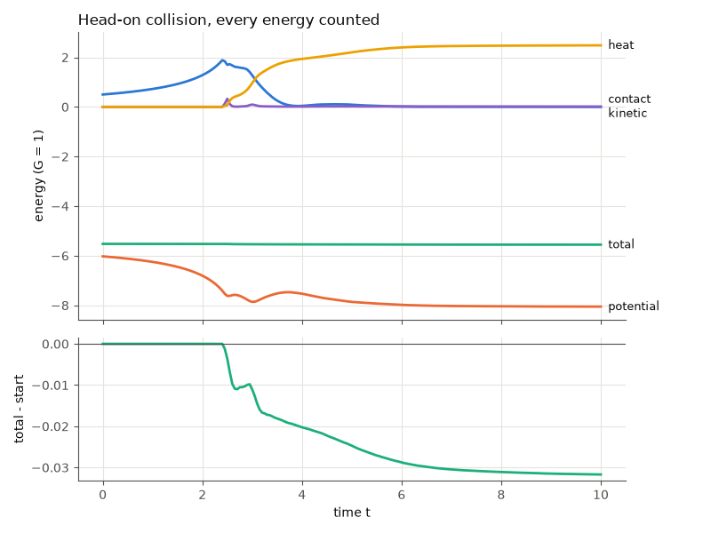
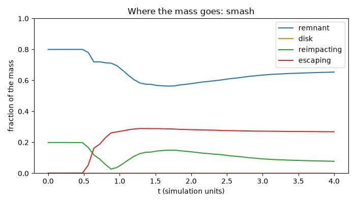

# Design Notes

A running log of the parallel-computing decisions in this project: what we chose, what we compared, and the evidence. This becomes the presentation. Add an entry whenever a decision is made or a benchmark settles a question. Include the numbers and the hardware.

**Entry format:** date · who · decision · why · evidence (benchmark, test, link to PR).

---

## Data layout

### Struct-of-Arrays particle storage (Oct 2026)
**Decision:** store particles as separate arrays per field (`x[]`, `y[]`, `z[]`, `vx[]`, …) in [src/particles.hpp](../src/particles.hpp), not an array of `{x, y, z, vx, ...}` structs.
**Why:** the force loop reads one field across many particles. With SoA those reads are contiguous, so the CPU can use SIMD and a GPU warp's loads coalesce into a few memory transactions. With an array of structs, each load pulls in fields the loop doesn't need.
**Evidence:** _TODO: benchmark AoS vs SoA in the OpenMP backend (milestone 3)._

---

## Module interfaces

### Fixed signatures before any physics (Oct 2026, #6)
**Decision:** every module (gravity, contact, integrator, init, io, config) got its header and stub bodies first, so both of us code against signatures that don't move.
- **One `SimParams` struct** ([src/params.hpp](../src/params.hpp)) is passed as `const SimParams &` to every physics function. Adding a setting never changes a signature, so one person's change can't break the other's code.
- Acceleration contract: gravity *overwrites* `ax/ay/az`; contact *adds* to them. [`compute_accelerations()`](../src/forces.hpp) is the one place that runs them in that order, and the integrator and planet relaxation both call it.
- **Backends are a plain enum** (`BACKEND_SERIAL / OMP / HIP`) chosen at run time, so every backend shares one interface and can be swapped by a flag.
- **Stubs abort** with `not implemented: <name>` instead of returning quietly, so an unfinished module can't make a test or run look correct.

**Why:** two people writing modules that call each other need a stable contract on day one; the overwrite/add rule is the kind of detail that otherwise causes silent double-counted forces.

### GPU tests live in their own binary (Oct 2026, #6 review)
**Decision:** CPU tests are every `tests/*.cpp`, built into one `sim_tests` binary. GPU tests go in `tests/gpu/*.cpp` (the CPU glob doesn't recurse, so it skips them) and build into a separate `sim_tests_gpu` binary only when `ENABLE_HIP` is on, with every test labelled `gpu`.
**Why:** CTest labels apply per binary, and CI has no GPU. One mixed binary would either fail to link without HIP or run GPU tests that `-LE gpu` can't filter out.

---

## Correctness strategy

### Compare backends with tolerances, not equality (Oct 2026)
**Decision:** backend-agreement tests compare a single force evaluation within a relative tolerance (~1e-12 for `double`), never `==`, and never after thousands of steps.
**Why:** floating-point addition isn't associative. Parallel reductions add the same numbers in a different order, so correct backends differ in the last few bits. And gravitational N-body systems are chaotic: those tiny differences grow until long runs diverge even when both are correct. Long runs are compared by conserved quantities (energy, momentum) instead.
**Evidence:** _TODO: plot of serial vs OpenMP divergence over time (milestone 3). It makes a good slide._

### Test at 1 and 4 threads in CI (Oct 2026)
**Decision:** CI runs the full suite with `OMP_NUM_THREADS=1` and `OMP_NUM_THREADS=4`.
**Why:** a data race can't happen with one thread, so a suite that passes at 1 thread and fails at 4 points straight at a race.

### Sanitizers in CI (Oct 2026)
**Decision:** AddressSanitizer + UBSan on every PR; ThreadSanitizer (with LLVM's Archer for OpenMP awareness) from milestone 3.
**Why:** memory bugs and data races often don't crash. They corrupt results silently or fail only sometimes. Sanitizers make them fail loudly and point at the line.

---

## Gravity

### The serial reference computes every pair twice (Oct 2026, #7)
**Decision:** [`compute_gravity_serial()`](../src/gravity_serial.cpp) loops "for each particle i, sum the pull of every other j", so each pair is computed twice (once from each side), with softening `eps` and G = 1.
**Why:** it's the simplest correct version, and it adds the numbers in the same order the OpenMP and GPU backends will (one particle per thread), so backend-match tests compare against an identically structured sum. Using Newton's 3rd law (each pair once, applied to both particles) halves the work but adds in a different order and needs atomics in parallel; #31 measures that trade-off.
**Evidence** ([tests/test_gravity.cpp](../tests/test_gravity.cpp)): 2- and 3-particle cases match hand-computed forces and potential to 1e-14 relative; 20 random particles match the same sum done in `long double` to 1e-13; the force equals minus the slope of the potential (central differences); and sum(m·a) over 100 random particles cancels to within 1e-12 of sum(m·|a|). During review, 19 deliberately broken copies of the gravity code (sign flips, swapped axes, single precision, missing pairs) were all caught by these tests.

### OpenMP gravity: first speedup (Oct 2026, #19)
**Decision:** [`compute_gravity_omp()`](../src/gravity_omp.cpp) is the serial loop with `#pragma omp parallel for schedule(static) default(none)` on the outer loop. Each thread owns a block of particles and is the only writer of their accelerations; positions and masses are read-only, so there are no races and no atomics. Each particle is summed by one thread in the same order as serial, so results match the reference.
**Evidence (correctness):** [tests/test_backends_match.cpp](../tests/test_backends_match.cpp) matches serial within 1e-12 relative at 1, 2, 4 and 12 threads, including N = 37 on 4 threads and N = 2 on 12. ThreadSanitizer with Archer (OpenMP-aware) reports 0 races; on a deliberately racy copy (shared running sum) it reports 9, so the check is real.
**Evidence (speed):** AMD Ryzen 5 7600X (6 cores / 12 threads), N = 10,000, `release` build, median of 9 interleaved rounds ([bench/bench_gravity.cpp](../bench/bench_gravity.cpp)). Reproduce with:
```bash
cmake --preset release && cmake --build --preset release
OMP_PROC_BIND=close OMP_PLACES=cores ./build/release/bench_gravity 10000
```

| OpenMP threads | s/eval | speedup vs 1-thread OpenMP | efficiency |
|---|---|---|---|
| 1 | 0.286 | 1.00x | 100% |
| 2 | 0.153 | 1.88x | 94% |
| 4 | 0.070 | 4.08x | 102% |
| 6 | 0.049 | 5.88x | 98% |
| 8 | 0.070 | 4.08x | 51% |
| 12 | 0.050 | 5.73x | 48% |

Across four runs, 6 threads gave 5.84–6.03x over 1-thread OpenMP. Serial took 0.28–0.33 s; it's the noisiest number, so the table compares against 1-thread OpenMP (the bench prints both).

**Why it looks like this:**
- Near-perfect up to 6 threads: each particle's work is independent and identical, there's no shared write, and N² math dominates memory traffic. One thread per physical core, no contention.
- **8 threads is *slower* than 6:** `schedule(static)` hands every thread an equal block, but with 8 threads on 6 cores, two cores run two threads each at about half speed. The whole loop waits for those slow blocks, so 8 threads finish no sooner than 4. This is the load-imbalance question #22 (static vs dynamic) investigates.
- 12 threads ≈ 6: the second hardware thread per core (SMT) shares the same floating-point units, and this loop already keeps them busy, so it adds nothing.
- Measurement lesson: the first runs showed "123% efficiency." That was noise, not magic: with the `powersave` governor, CPU boost and other programs running, the clock speed drifts between measurements. The benchmark now interleaves configurations each round and reports speedup against 1-thread OpenMP as well as serial.
- **1-thread OpenMP is 3–16% faster than serial** (varies run to run) with identical math and bit-identical results. The compiled code shows why: serial's inner loop re-loads the `y`, `z` and `mass` array addresses from the `Particles` struct on every iteration (the compiler can't prove the writes to `ax/ay/az` don't change them), while the OpenMP version copies them into local pointers that stay in registers. The serial reference is deliberately left unoptimized (CLAUDE.md).

### HIP gravity: naive double kernel (Oct 2026, #24, #25)
**Decision:** [`compute_gravity_hip()`](../src/gravity_hip.hip) runs one GPU thread per particle (256 per block), each looping over all others in global memory with the same formula and summation order as serial, in `double`. The GPU copies of the arrays (Struct-of-Arrays) are kept between calls and grow only when N does; positions and masses go up and accelerations come back on **every call**. HIP is optional: `cmake --preset hip` (`ENABLE_HIP`, `gfx1200`); other builds report `--backend hip` as not built.
**Device choice:** ROCm lists two devices on the dev PC: the RX 9060 XT (`gfx1200`) and the Ryzen 7600X's integrated GPU (`gfx1036`). `hip_init()` picks, with the pure function `pick_gpu()`, the visible device with the most compute units **among the architectures the kernel was compiled for** (`CMAKE_HIP_ARCHITECTURES`, passed in as `SIM_HIP_ARCHS`), so the discrete card wins regardless of ordering and `HIP_VISIBLE_DEVICES` overrides. The `hip` preset compiles for **both** chips: review found that with ROCm 7.2, if *any* visible GPU lacks code for a kernel, the first launch aborts inside the HIP runtime (exit 134, no error our checks can catch), even when the chosen GPU has code. A GPU outside the list is never chosen; if it's the only one, or there's no GPU at all, `planet_sim` exits 1 with a message and GPU tests skip. `pick_gpu` is unit-tested on the CPU ([tests/test_gpu_select.cpp](../tests/test_gpu_select.cpp)), since on this PC "first device" and "best device" are the same card and GPU tests alone can't tell them apart. `hipSetDevice` is per host thread, so `compute_gravity_hip` sets it on every call. In the `--bench` line, hip runs report `threads=0` (no CPU threads compute gravity).
**Practical size:** one kernel launch per step, measured 0.89 s/step at N = 65,536 and 7.4 s at 200,000 (O(N²)). The CLI's 10M cap would mean hours per launch on the GPU that also drives the display, so keep `--backend hip` to roughly N ≤ 1e5 until #26 and #32 speed it up.
**Why double first:** it matches the serial reference to 1e-12, so correctness is checked strictly before any precision trade-off. `float` is #32.
**Evidence (correctness):** [tests/gpu/test_backends_match_gpu.cpp](../tests/gpu/test_backends_match_gpu.cpp) (label `gpu`): hand-computed pair to 1e-14; one particle with eps = 0 gets exactly zero (self-pull skipped, else NaN); N = 2, 255, 256, 257, 1000 and 4096 match serial within 1e-12 relative; cached buffers survive grow/shrink/free; 10 leapfrog steps track serial positions to 1e-10. Eight deliberately broken kernels (no self-skip, blocks rounded down, float math, swapped axis, stale mass after reuse, eps not squared, missing copy-back, buffers never regrown) were all caught: six by tests, one by the HIP error check, one by `-Werror`.
**Evidence (speed):** whole `planet_sim --bench` step (gravity + leapfrog, including the copies), `cloud` scenario, OpenMP from the `release` build with 6 threads pinned to cores:

| N | OpenMP 6 threads (s/step) | HIP naive double (s/step) | HIP vs OpenMP |
|---|---|---|---|
| 2,000 | 0.0018 | 0.0030 | 0.6x (slower) |
| 10,000 | 0.044 | 0.034 | 1.3x |
| 30,000 | 0.41 | 0.20 | 2.1x |

**Why it looks like this:**
- Double precision is slow on this card. Consumer RDNA GPUs run `double` at a small fraction of `float` speed. A scratch probe of the kernel alone at N = 10,000 took 25 ms in `double` vs 2.0 ms in `float`, so in `double` the GPU only modestly beats 6 CPU cores. #32 measures the `float` version properly.
- Small N loses. At 2,000 particles the fixed costs (kernel launch, seven host↔device copies per step) outweigh the math; the GPU only pays off as N² grows. #30 removes the per-step copies.
- No data reuse yet. Every thread reads every other particle from global memory; #26 (shared-memory tiles) loads each block of particles once and shares it.

**Build gotcha (Arch ROCm 7.2):** the ROCm clang guesses its install root as `/opt/rocm/lib` and can't find `hip/hip_runtime.h`; the `hip` preset passes `--rocm-path=/opt/rocm` and pins the compiler and ROCm root so it works from any shell.

### Fast GPU forces: float, tiles, and contact in the kernel (Nov 2026, #26, #32, #66)
**Decision:** one kernel, [`force_kernel<T>`](../src/gravity_hip.hip), computes gravity and, when contact is on, the contact forces and heat rate, with exactly the rules of `compute_contact_bruteforce`. The all-pairs loop already visits every pair, so contact costs almost nothing there and nothing is left running on one CPU thread; `compute_accelerations` calls `compute_forces_hip` for the hip backend instead of gravity plus the CPU grid contact. The kernel computes in float by default, with double selectable (`--gpu-precision`, viewer key `P`). It is written once for both precisions, which is the only reason the repo has templates. Double stays the reference: it still matches serial to 1e-12, and the older GPU tests run in double. Relaxation always runs in double, so a float run and a double run start from the same planets.

Positions are passed as two floats each, x = hi + lo, and the separation of two particles is computed as (xj_hi − xi_hi) + (xj_lo − xi_lo). In plain float, positions at x = 2.5 step by 2.4e-7 while touching particles overlap by about 1e-4, and some contact forces came out 44% wrong (found in the plan review); with the split, contact at x = 2.5 is as accurate as at the origin. Velocities stay plain float: the damper only needs their difference, and at the speeds in our scenarios the rounding is far below the measured error. Particles are read in tiles of 256 through shared memory, the last tile's padding is skipped by index, and every thread reaches every sync.

**Evidence (speed):** `planet_sim --bench`, Ryzen 5 7600X and RX 9060 XT, CPU numbers from the release build, ms per step:

| | Serial | OpenMP, 6 threads | GPU before (naive double) | GPU now (float, tiled, contact in kernel) | vs serial | vs OpenMP |
|---|---|---|---|---|---|---|
| head_on.cfg, 4,000 particles with contact | 52.5 | 10.3 | 9.0 | 1.1 | 48x | 9.4x |
| cloud, 10,000 | 287 | 52.7 | 30.5 | 2.1 | 137x | 25x |
| cloud, 50,000 | 7,198 | 1,271 | 564 | 29 | 248x | 44x |

Float gave the big gain, 15 to 20x (10k: 32.9 → 2.1 ms; 50k: 571 → 29 ms), because this consumer card has far less hardware for 64-bit math. Moving contact into the kernel took head_on from 3.7 to 1.1 ms: before, gravity took about 0.5 ms on the GPU and grid contact about 3 ms on one CPU thread, which is Amdahl's law in one line. Tiling did nothing measurable. In double it was even slightly slower (cloud 10k 30.5 → 32.9 ms, from the extra hi/lo adds), because in double the card is limited by its 64-bit math, not by memory. In float the whole step at 50k (29 ms) is about what the untiled kernel alone took in the October probe (30 ms): the card's caches already serve the repeated reads tiling is meant to save.

**Evidence (accuracy):** [tests/gpu/test_forces_gpu.cpp](../tests/gpu/test_forces_gpu.cpp). Float gravity matches serial to 3.5e-6 relative at N = 2 to 4,096, and the tests also require the error to be above 1e-10, which proves the float kernel ran. With contact, on two planets pressed together and approaching, float matches the CPU to 1.2e-4 of |a_grav| + |a_contact| per particle and the heat rate to 1.7e-7 of the largest; double matches to 1e-15. A hand-computed approaching pair at x = 2.5 checks force and heat in both precisions. A 300-step float collision keeps momentum to 1.8e-9 and angular momentum to 2.6e-9 (double gets ~1e-15), and its energy total stays within the same 1.5e-4 as on the CPU. A flipped damper sign, a dropped heat factor, plain float positions, unskipped padding, and relaxation left in float each failed tests.

**Float vs double over the whole head-on run** (5,000 steps, same relaxed start): 12.6 s vs 28.0 s, and the energy total changed by −0.0312 vs −0.0320, the known heat-bookkeeping gap in both, so float costs no energy accuracy. These full runs are 2.5 and 5.6 ms per step rather than the 1.1 ms in the table because they also write 201 frames and compute the O(N²) energy log on the CPU; and at 4,000 particles the GPU's fixed per-step costs (copies, launch) are a larger share, which is why float is only 2.2x faster here instead of 15 to 20x. The two runs' trajectories drift apart (kinetic energy differs by up to 0.011), as any chaotic system does.

In the viewer: 50,000 particles at 26 ms per step and 35 fps; the head-on collision at 60 fps with 8 steps per frame. At 50k the O(N²) gravity itself is most of the frame, which is what Barnes-Hut (#35) is for.

---

## The simulation program

### `planet_sim`: loop, outputs, built-in scenarios (Oct 2026, #14)
**Decisions:**
- **One loop** ([`run_simulation()`](../src/sim.cpp)): `compute_accelerations()` once (the leapfrog contract), then leapfrog steps. A frame and an energy row at step 0, every `output_every` steps, and the final step (so the log always covers the whole run); potential energy is O(N²) and serial, so it's never computed on other steps. Frames are numbered 0, 1, 2, ... in output order.
- **Command-line overrides** live in [`apply_overrides()`](../src/cli.cpp), which also refuses unusable runs: a config with no `steps` (a 0-step run would "succeed" doing nothing), a non-finite or non-positive `dt`. Typos like `--dt inf` are usage errors (exit 1), not "the physics exploded" (exit 2).
- **NaN/Inf check after every step** (one O(N) pass, negligible next to O(N²) gravity). The run stops at the first bad particle and exits with code 2, so "the physics exploded" can't look like success.
- **Built-in scenarios** (`--scenario orbit|figure8|cloud`) so the program runs before the config loader (#13) and planet generator (#9) exist: benchmarks (#20) and tests (#16) can start now. Collisions come from config files.
- **Planets are built at rest at the origin**, relaxed, then placed with `place_planet()` (the #15 contract), and forces are recomputed for the combined system before stepping.
- **`--bench`** writes nothing and prints one line for scripts: `bench backend=omp n=5000 threads=6 steps=20 seconds_per_step=0.0121`.
- Exit codes: 0 ok, 1 usage/setup error, 2 NaN/Inf.

**Evidence:** [tests/test_sim.cpp](../tests/test_sim.cpp) checks the loop gives the same bits as hand-written leapfrog steps, the energy log's rows and conservation, NaN detection, CLI parsing; CTest also runs the real `planet_sim` binary and checks exit codes and output ([tests/CMakeLists.txt](../tests/CMakeLists.txt)). First end-to-end OpenMP number through the real program: a 5,000-particle cloud, 0.077 s/step serial vs 0.012 s/step with 6 threads (6.4x), Ryzen 5 7600X, `release`.

**Lessons:**
- The first version of the program-level tests passed two error cases *for the wrong reason* (CMake split the argument list, so every run failed with "missing value"). Each error test now matches its specific message, which then caught a real bug: a trailing unknown flag was reported as "missing value".
- Review deliberately broke 34 copies of this code and **17 still passed the tests**: the gaps were at the program level (overrides, the NaN exit code, a mid-run NaN, `--dt inf`). After adding those tests (including one that blows up during step 1 and a `/dev/full` "disk full" test for the energy log), they're covered. Also caught: CI still ran `planet_sim` with no arguments, which became a usage error and blocked the PR. Branch protection did its job.

### Frame files: one CSV per output step (Nov 2026, #10)
**Decision:** [`write_frame()`](../src/io.cpp) writes `<out>/frame_00042.csv` with a header line `id,x,y,z,body` (since #50 `id,x,y,z,vx,vy,vz,mass,body,material,heat`, see layered planets below) and one row per particle. Doubles use `%.17g`, which is enough digits to read back the exact same double. The file is opened in binary mode so lines end in `\n` on every OS (Windows text mode would write `\r\n`). [`read_frame()`](../src/io.cpp) is strict about structure: wrong header, wrong number of columns, a non-number, a body that doesn't fit in an `int`, ids not 0, 1, 2, ... in order, a blank line anywhere but the very end, a NUL byte, or a line too long for its line buffer all return false and leave the caller's particles untouched. It accepts what an editor might do to a file: `\r\n` line endings, no newline after the last row, or one blank line at the end. Within a field it is as lenient as `sscanf` (a leading space, a `+` sign or a hex float like `0x1p3` still read), which is harmless for files `write_frame` wrote.
**Why:** CSV with a header is what the render script (#11) and anyone poking at a run can open directly in pandas or a spreadsheet, and it matches `energy.csv`. At first only positions and body ids went in, because that's all rendering needed; #50 then added the other columns in one change (see layered planets below). A strict reader means a truncated or hand-edited frame fails loudly instead of rendering as a planet with missing particles.
**Evidence:** in this first format a frame was about 68 bytes per particle (136 KB at 2,000 particles, 687 KB at 10,000); since #50 it is about 170, with a 512-byte line buffer for rows of up to about 245 characters. Writing one takes about 1 ms at 2,000 and 6 ms at 10,000 (Intel Core Ultra 7 155H, WSL, gcc `-O2`), small next to a step at those sizes, and frames are only written every `--output-every` steps. [tests/test_io.cpp](../tests/test_io.cpp) checks a bit-for-bit round trip (including -0.0, subnormals, NaN and inf, and a real two-planet frame) and each malformed case; two CTest runs of the real `planet_sim --out` check the frame count, including the extra frame at a final step that isn't a multiple of `--output-every`. A full disk is tested by pointing the frame's file name at Linux's `/dev/full` (a device that fails every write) with a symlink, and a test in [tests/test_sim.cpp](../tests/test_sim.cpp) checks that a frame that can't be written stops the run. We ran 21 deliberately broken copies of `io.cpp` and `sim.cpp` against the tests; 17 made a test fail and one more (dropping the NUL-byte check) is caught by AddressSanitizer in CI as a read before the start of the line buffer. The three that pass don't change behavior on Linux: writing in text mode (only differs on Windows), skipping the `ferror` check (with `/dev/full` the final `fclose` fails too), and skipping the null-path check (glibc's `fopen` already returns null).

### `render.py`: quick-look video from frame files (Nov 2026, #11)
**Decision:** [`scripts/render.py`](../scripts/render.py) reads a folder of frames, checks each one the way `read_frame()` does (exact header, 5 columns, ids 0, 1, 2, ... in order, whole-number bodies, no comment lines, no blank lines except one at the end; `\r\n` and nan/inf are fine), and draws a matplotlib 3D scatter per frame colored by planet. matplotlib's `FFMpegWriter` sends each image straight into ffmpeg (H.264, `yuv420p` so browsers and phones play it), with no PNG files in between. ffmpeg itself comes from the `imageio-ffmpeg` pip package, so `pip install -r scripts/requirements.txt` is the whole setup on every machine, with no root needed. All 12 packages are pinned, matplotlib's own dependencies included: the first version pinned only the three we import, pip then picked pyparsing 3.3.3, which is newer than matplotlib 3.10.3 and prints deprecation warnings on every run. A later pyparsing could break CI with no change on our side.
**Camera:** the axes are fixed for the whole video, so the view doesn't zoom as things move. A first pass over the frames finds one cube that holds every particle except the farthest 0.5% on each side of each axis, and particles outside it are clipped. The first version used every particle, and in a gravity-only test run a few particles flung out to about 30 planet radii shrank the planets to a dot for the whole video.
**Evidence:** two generated planets of 2,000 particles each, 121 frames (32 MB of CSV), render at about 9 frames per second into a 276 KB, 4-second video (Intel Core Ultra 7 155H, WSL). That's slow next to the viewer but fine for a debug tool, and `--every k` skips frames for long runs. [scripts/test_render.py](../scripts/test_render.py) (15 tests) checks loading and rejecting frames, numeric frame order, the camera box (widest axis, stragglers, nan/inf), the video's frame count and length, and clean errors for bad paths; CI's `render` job runs them and renders a real `planet_sim` run. Review ran 27 broken copies of the script and 14 passed the old tests. The tests added since catch 8 of those 14. Five more only change how the video looks (no clipping, one color for every planet, old points not erased, axis limits not set, a pixel format some players can't open), which you see by watching the uploaded video. The last one switches the box to interpolated percentiles, which moves it by under 1%.

### Scenario files: `key = value` with numbered planets (Nov 2026, #13)
**Decision:** [`load_config()`](../src/config.cpp) reads one `key = value` per line, with `#` comments, and planets as `planet0.n`, `planet1.radius`, and so on. Planet N gets body id N, so frames color it the same way every run. Center and velocity are three numbers separated by spaces. Any error (unknown or repeated key, a value that isn't entirely one finite number of the right type, planets numbered with a gap, a planet missing `n`, `radius`, `particle_radius` or `mass`) prints `file:line: reason` with the line and leaves the `Config` untouched. `output_every` is required, and so is at least one planet. Each planet is also run through [`planet_spec_ok()`](../src/init.hpp), the same checks `make_planet` aborts on, so a negative `n` or a `particle_radius` too big for the planet is a clean error naming the planet (exit 1), not a crash. `softening`, `contact_c` and the `relax_*` values must be at least 0, and `contact = true` needs `contact_k > 0`. `dt`, `steps` and `output_every` are left to `apply_overrides`, because command-line flags can still replace them. A UTF-8 byte order mark at the start of the file is skipped, and a directory is rejected as "not a regular file". The files are [configs/head_on.cfg](../configs/head_on.cfg) and [configs/smoke.cfg](../configs/smoke.cfg).
**Why:** the issue asked for plain `key = value`, and a numbered prefix keeps every line self-contained, while `[planet]` sections would make a key's meaning depend on where it sits in the file. Unknown keys must fail, because a typo like `stpes = 5000` would otherwise silently run with the default. Repeated keys fail for the same reason: with two `dt` lines, only one of them takes effect, and nothing says which. `output_every` has no safe default. With the old default of 1, every step writes a frame and computes the O(N²) potential energy, which costs about as much as the step itself. `strtod` accepts `nan` and `inf`, so the loader rejects non-finite values itself. The first version left range checks to `make_planet`, but `make_planet` aborts (exit 134 and a core dump, or a closed viewer window), and a wrong number in a config is the most common mistake people will make. Sharing one check function keeps the loader and the generator from disagreeing. Windows PowerShell 5.1's `Out-File` writes the byte order mark, and without the skip it turned the first key into `output_every`.
**Choosing the config values:** both files use particle mass 1e-3, `k = 20`, `c = 0.05` and `dt = 0.002` from the kickstart preview. The spring period `2π·sqrt(m_eff/k)` is 0.031, so `dt` is T/15.7 (limit T/10), and `c·dt/m_eff = 0.2` (limit 2, see Contact). head_on uses 2,000 particles per planet with `particle_radius = 0.065`, where FCC neighbors just touch. That is 94% of the 0.0688 limit. Its planets start at a relative speed of 1, half the pair's escape speed of 2 at contact, and gravity speeds them up to about 1.84 (92% of escape speed) by the time they touch. Their total energy is ½·1·1 − 2·2/5 = −0.3, so they are bound and should merge. smoke started with the same 0.065 at radius 0.5 and `make_planet` refused it: the margin `radius - particle_radius` takes a larger share of a small ball. The limit for 250 particles at radius 0.5 is between 0.062 and 0.065, so smoke uses 0.06.
**Evidence:** [tests/test_config.cpp](../tests/test_config.cpp) (14 tests) loads every key from a sample file, checks that missing keys keep their values and that Windows line endings and a byte order mark load, and checks each error message, including the line number after comments and blank lines. It also loads both shipped files. Each test writes its files in a folder named after the process id and the test, because the first version shared one file and two test runs at once (two presets, or `ctest -j`) failed about 3,700 times each in 300 repeats; now 0. `Cli.SmokeConfigRuns` and `Cli.HeadOnConfigRuns` build and run both files, and the smoke test caught the 0.065 problem above. `Cli.BadPlanetConfigIsSetupError` checks that a planet `make_planet` can't build gives exit 1. In review, 10 broken copies of the loader (line numbers that skip comments, no space check between vector numbers, no seed upper bound, no underflow check, no byte order mark skip, no planet or range checks, and others) each failed a test.
**Smoke timing:** 200 steps of 500 particles (Intel Core Ultra 7 155H, 22 threads, WSL, RelWithDebInfo) take 0.18 s serial, 0.10 to 0.12 s with OpenMP on 4 threads (about 1.7x), and 1.06 to 1.25 s on all 22 threads, about 6x slower than serial. Only gravity is parallel so far (contact is still serial), and at 500 particles each of 22 threads gets about 23 particles per step, so starting and joining the threads every step costs more than the work it splits. CI should run the smoke test on the serial backend or a few threads.
**Energy:** the full smoke run's logged energy only falls, by 0.0029. The first 300 steps of head_on (4,000 particles, about 12 s on 22 threads), logged every 25 steps as the file says, show two clear rises in kinetic plus gravitational energy, +0.065 at step 125 and +0.026 at step 275 (and one of 7e-8 at step 25). Counting the energy stored in compressed contact springs (`½·k·δ²` per overlapping pair, computed from the frames) removes both: that total only falls, from -5.366 to -5.498. The unrelaxed planets sag under their own gravity and spring back, and relaxation (#15) will damp that out. `energy.csv` does not include spring energy yet.

### `planet_view`: live viewer with backend switching (Oct 2026, #45, #48)
**Decisions:**
- One step at a time: `run_simulation` is now built on [`sim_init()` and `sim_step()`](../src/sim.cpp), and the viewer calls the same two functions, so it runs exactly the physics `planet_sim` runs (same setup flags, same config/relaxation path).
- Simulation and drawing share one thread. Each frame runs steps until a time budget (12 ms by default, `[`/`]` to change) is used, always at least one, then draws. No locks or races. A slow backend slows the window too, which is what the demo should show: at 10k particles serial drops to a few fps.
- Backend switching needs no data movement (yet). All state lives in host `Particles`, and the HIP backend copies positions in and accelerations out on every call, so `1`/`2`/`3` just change which backend the next step uses. Once #30 keeps data on the GPU, switching away from HIP must copy it back first.
- **raylib 5.5**, pinned and built from source behind `ENABLE_VIEWER` (default off), so CI's normal jobs and anyone without X11/OpenGL never touch it. Particles are drawn as small camera-facing squares in one batch; the glow look is #47.

**Evidence:** `SimStep.*` in [tests/test_sim.cpp](../tests/test_sim.cpp): stepping one at a time gives the same bits as `run_simulation`; serial → OpenMP → serial matches serial throughout; a GPU version (serial → HIP → serial) matches within 1e-10 relative. CI's `viewer` job runs `planet_view` for 60 frames on a virtual screen (Xvfb, software OpenGL).

Live numbers on the dev PC (`demo` preset, 10,000-particle `cloud`, 1280×800 window):

| Backend | ms/step | fps |
|---|---|---|
| serial | 278 | 4 |
| OpenMP (12 threads) | 46 | 21 |
| HIP (naive double) | 26 | 38 |

These match `planet_sim --bench` for the same N, so drawing costs little next to the physics at this size.

---

## Time integration

### Leapfrog (kick-drift-kick) instead of Euler (Oct 2026, #8)
**Decision:** [`leapfrog_step()`](../src/integrator.cpp) advances the simulation as: half-step velocity kick, full-step position drift, recompute forces, half-step kick. Forces are computed once per step.
**Why:** leapfrog is *symplectic*: it preserves the geometry of orbital motion, so its energy error wobbles but never builds up. Euler updates positions and velocities from the old state only, so every orbit adds a little energy, and orbits spiral outward. Leapfrog costs the same one force evaluation per step.
**Evidence:** the same two-body circular orbit (G = 1, period 2π, 1,000 steps per orbit, 1,000 orbits) through both methods:

| Worst energy error so far | after 1 orbit | after 10 | after 100 | after 1,000 | separation at the end (starts at 1) |
|---|---|---|---|---|---|
| **Leapfrog** | 3.9e-10 | 3.9e-10 | 3.9e-10 | 3.9e-10 | 1.00 |
| **Euler** | 6.8e-2 | 3.3e-1 | 6.6e-1 | 8.4e-1 | 6.42 |

Relative energy error |E − E₀|/|E₀|, worst value seen up to that point (checked every step). The numbers are identical with gcc `-O2` and `-O3 -march=native`. Leapfrog's error wobbles within each orbit, peaking at 3.9e-10, and that peak never grows: it's a fixed property of the method at this step size, not accumulated error. Euler is off by 7% after one orbit and keeps getting worse: the orbit spirals outward to 6× its starting separation. [tests/test_two_body.cpp](../tests/test_two_body.cpp) enforces < 1e-5 with no drift; during review it caught 8 deliberately broken integrators, including one losing 1e-11 of its speed per step.

---

## Planets

### FCC lattice with a small seeded jitter (Nov 2026, #9)
**Decision:** [`make_planet()`](../src/init.cpp) takes the `n` points of a face-centered cubic (FCC) lattice closest to the origin, shifts them so their mean is at the planet's center, scales the lattice to the largest spacing that keeps every center within `radius - particle_radius - jitter`, and moves each particle by a random offset of at most 2% of `particle_radius`. The seed only controls that offset. If that spacing would let neighbors overlap by 10% of `particle_radius` or more, `make_planet` aborts with the spec in the message instead of building a planet that explodes on its first contact step.
**Why:** a purely random fill can't meet the "overlap under 10%" rule at any useful density, and random filling with a minimum distance stops at about 38% packing and is O(N²) without a grid. FCC is the densest regular packing (74%), so the planet starts close to its settled size and relaxation (#15) has less to fix. A simple cubic grid packs only 52% and has flat planes that shear easily.
**Same seed, same planet, on every build:** measured in half cube sides, FCC points are the integer triples with an even sum, so the code picks and orders the `n` closest points by exact integer distance. A first version sorted on floating-point distances, and the release preset's `-march=native` turns `x*x + y*y + z*z` into fused multiply-adds (FMA, one rounding instead of two). That reordered points that tie within a shell, and 1,003 of 2,000 particles landed somewhere else than in the dev build. With integer keys the two builds now differ by at most 1.1e-16. The jitter comes from the raw 64-bit output of `std::mt19937_64`, which the standard fixes exactly, not from `std::uniform_real_distribution`, which libstdc++ (Linux) and libc++ (macOS) implement differently. `Init.MatchesStoredPlanet` checks a stored 13-particle planet, so CI's gcc and clang builds must agree.
**Centering:** the last lattice shell is usually only partly filled, and the first version left the planet's center of mass up to 2% of the radius off center at a few hundred particles (47% for n = 2). Subtracting the mean brings that down to the jitter: 8.5e-6 of the radius at n = 2,000 and 3.6e-4 at n = 2.
**Evidence:** for 2,000 particles in a unit ball, the largest `particle_radius` that passes is about 0.0688 (worst overlap 9.7% of `particle_radius`); 0.069 aborts. At 0.068 the worst overlap is 7.2%, and at 0.065 neighbors just touch (-2.6%, a small gap). The tests pin the limit from both sides (0.068 must work, 0.07 must abort). We also ran 21 deliberately broken copies of `make_planet` (overlap limit raised to 20%, jitter in a cube instead of a ball, farthest points kept, no centering, wrong seed, and so on) against the tests, and every one made a test fail.

### Layered planets: an iron core inside a rock mantle (Nov 2026, #50)
**Decision:** a planet can have a core: `core_radius_fraction` of the radius the particle centers fill, and a `core_density_ratio`. Every particle keeps the same size, so contact and the contact grid are unchanged; core particles are just heavier, `m_core = ratio × m_mantle` with `m_mantle = mass / (n_mantle + ratio × n_core)`, so the planet still weighs `mass`. The core is whole shells of the lattice around its origin, picked by exact integer distance, so it is symmetric and the same on every machine. Each particle carries a `material` (0 rock, 1 iron) through relaxation, placement and the frames. The defaults (no core) give exactly the planets from before, bit for bit.

**Why one particle size:** different sizes would make the contact grid slow (its cells are sized for the largest particle, the limit in #62). Iron is about 2.5 times as dense as the rock of a planet's mantle (Earth's core and mantle average roughly 11 and 4.5 g/cm³), so heavier particles are the simple way to get the right mass distribution. With 0.55 and 2.5, a 2,000-particle planet has 321 core particles holding 32% of the mass, close to Earth's core.

**Centering:** the lattice is now centered on its mass-weighted mean rather than its plain mean, so the planet's center of mass stays at its center with a heavy core (centering on the plain mean put it 2.5e-3 of the radius off). Because the outermost shell is only partly filled, the symmetric core then sits 4.9e-3 off the center of mass, 3.8% of the particle spacing. The damper-stability note now checks the truly lightest particle, a mantle particle, which with a core is 19% lighter than `mass / n` (8.06e-4 instead of 1e-3 for a 2,000-particle planet of mass 2).

**Evidence:** [tests/test_layered.cpp](../tests/test_layered.cpp) checks exact unlayered planets, the masses, the core share, the centering, the checks on bad values, the tiny-core note, and the damper note. A relaxed 250-particle layered planet keeps its core within 1% of a particle spacing of the center, and its largest overlap is 0.12% of a particle radius. That shows relaxation keeps the layers; it can't show a light core would rise, which takes far longer than relaxation runs. Making the core no heavier, centering on the plain mean, using `mass / n` in the damper note, dropping `material` in `place_planet`, and letting the frame reader split overlong lines each failed tests.

**Frames since #50:** `id,x,y,z,vx,vy,vz,mass,body,material,heat`, one format change that also serves the impact analysis (#67) and the replay (#49). About 170 bytes per particle per frame: the head-on run (4,000 particles, 201 frames) writes about 140 MB, and 50,000 particles over 300 frames would write about 2.6 GB. `--bench` writes no frames, so timings are unaffected. `scripts/render.py` reads the new format and tells you to rerun `planet_sim` on older frames.

### Relaxation: velocity drag until calm for a dynamical time (Nov 2026, #15)
**Decision:** [`relax_planet()`](../src/init.cpp) takes normal leapfrog steps (gravity and contact) on one planet at rest at the origin, and after each step multiplies every velocity by `exp(-relax_drag·dt)`. It stops once the planet's kinetic energy has stayed below `relax_ke_threshold` for one dynamical time `sqrt(R³/(G·M))` in a row, where R is the farthest particle center from the center of mass, or after `relax_max_steps`. `relax_drag` is a new config key. `relax_planet` reports how it ended (steps, hold, dynamical time, settled, finite), and `build_planets` prints a note for a planet that used all its steps (with the kinetic energy it reached and the hold it needed), one that became NaN/Inf, or a drag too strong to trust (below), and the run goes on. A threshold of 0 is rejected when relaxation is on, since kinetic energy is never below 0. `planet_sim` and `planet_view` now start through one function, [`setup_run()`](../src/sim.hpp), which applies command-line overrides before building planets, so relaxation uses the checked `dt` and `--dt` reaches it too.
**Why the hold:** a fresh lattice planet sags under its own gravity and rebounds, and its kinetic energy passes near zero at each turning point. With drag 5, the 2,000-particle planet's kinetic energy was 3.1e-4 at step 150 and back up to 1.1e-3 at step 250, so "stop at the first reading below the threshold" could stop mid-bounce. A planet at rest also starts with zero kinetic energy, below any threshold. Holding for a dynamical time handles both, and needs no extra setting: it is about 320 steps for the head-on planets and 290 for the smoke planets, longer than the 100 steps from that dip to the next peak. The hold is a time, so a smaller `dt` needs a larger `relax_max_steps`: at a quarter of the configs' `dt` the hold alone is about 1,160 (smoke) and 1,280 (head-on) steps, so 2,000 steps run out and the note says so. The step count `ceil(t_dyn/dt)` is clamped before it is turned into an int: with `dt = 1e-12` it is 5.8e11, which overflowed to a hold of 1 in review, so an unrelaxed planet counted as settled after one step.
**Why drag, not more contact damping:** the drag slows every particle, including loose ones that touch nothing. Contact damping alone (`c = 0.05`) does settle both planets, just more slowly. Without drag the 2,000-particle planet still had kinetic energy 3e-6 after 1,500 steps, while with drag 5 it stayed below 1e-6 from about step 500. Too much drag fails differently: the planet only creeps toward its settled shape, so its kinetic energy stays under the threshold while it is still far from settled. On the smoke planet (t_dyn = 0.58), relaxing with threshold 1e-6 and then running 500 steps without drag gave a peak kinetic energy of 6e-7 at drag × t_dyn = 145 (settled) but 7.9e-4 at 203 and 8.9e-4 at 290, where relaxation had stopped after exactly one hold. The 2,000-particle planet still settled at 160. `build_planets` warns above drag × t_dyn = 100, half the first failure; the configs use 2.9 (smoke) and 3.2 (head-on). The drag changes velocities after the step's forces were computed, so contact's damper term in the stored accelerations is from the pre-drag velocities. That is a small error in a phase whose only job is to settle the planet, and fixing it would cost a second force evaluation per step.
**Evidence:** with the config values (drag 5, threshold 1e-6, at most 2,000 steps), the head-on planets settle in 866 and 865 steps, ending at kinetic energy 1.8e-9 and 1.5e-9. The smoke planets settle in 499 and 497 steps. Their outer radius shrinks by 3.0% (0.9995 to 0.9700) and 1.5% (0.4981 to 0.4908), well inside the issue's 10%. The planets no longer sag and rebound during the run: in the first 300 steps of the head-on run, kinetic plus gravitational energy rose by about 2e-6 at most between log rows, against +0.065 and +0.026 without relaxation (#13). Relaxing head_on's two planets took 53 s and 61 s on 22 threads in two runs (the second with another job running). The smoke planets take 7.4 to 7.8 s each on 22 threads but well under a second serially, the same thread-overhead effect as in the smoke timing (#13). [tests/test_relax.cpp](../tests/test_relax.cpp) checks that a planet settles below the threshold and stays settled without the drag, that its radius changes by less than 10%, that it doesn't drift, that the hold covers a whole dynamical time (including an eccentric orbit whose short dips must not add up), and the step limit, the drag, `build_planets` and its note. `Cli.DtOverrideReachesRelaxation` checks the new order. It also checks the exact drag rate on a lone particle, a 0 threshold, settling on the last allowed step, a hold too long for an int, a blow-up, OpenMP against serial, each `build_planets` note, and `setup_run`. Review ran 26 broken copies and 10 passed the first tests. Six of those now fail a test: the drag applied twice per step, `<=` for `<`, the note naming the wrong planet or printing the threshold as the kinetic energy, a note one step early, and `--dt` reaching relaxation but not the main run. Moving the viewer's setup into `setup_run` also put its order under test. Four are left on purpose: measuring kinetic energy before instead of after the drag, applying the drag before instead of after the step (at drag 5 the two orders differ by 2% of kinetic energy per step), a hold of 0 instead of 1 for a one-particle planet, and restarting the calm count at 1 instead of 0. In all, 19 broken copies were run after the fixes and each failed a test.

---

### The viewer's look: glow, heat and real-size particles (Nov 2026, #47)
**Decision:** particles are drawn as soft round sprites whose light adds up (additive blending), sized from each particle's real radius (2.5 radii for the glow, never under 1.5 pixels on screen). Before, every square was the same size on screen at any zoom, so zoomed out they covered each other and a dense core looked the same as thin debris. Color comes from [`src/look.cpp`](../src/look.cpp), plain functions with their own tests: heat (the default), material, planet, speed and plain, cycled with `c`. In heat mode a cold particle shows its material dimmed (iron cores stand out in rock mantles) and heat adds a glow on top that goes dark red, orange, yellow and then white, on a log scale from 0.003 to 1 times the scenario's heat scale. That scale is fixed per scenario, from the larger of the two main bodies' impact speed and their mutual escape speed (0.5 v² per unit mass, about the impact's kinetic energy per unit mass), so a color means the same thing for the whole run. Heat is divided by mass, so a heavy iron particle isn't drawn hotter than a light rock one with the same heat per mass. Hot particles also emit more light, up to 8.6 times a cold one: without that, a lone white-hot speck of debris added so little light that it came out gray while a dense cold core came out bright (found in review). A small sprite shader carries that intensity past the 1.0 that a vertex color's alpha allows.

**Why a float scene and hue-keeping brightness:** the sprites draw into an offscreen texture with 16-bit float channels. In 8-bit channels the hundreds of sprites overlapping in a planet's core clip to white, and in heat mode white means white-hot, so a cold core would look as hot as the impact (found in the plan review). A final pass then compresses brightness by each pixel's brightest channel, which keeps its hue exactly: our first version scaled by overall brightness and turned the orange planet pale yellow. Sprites draw with the depth test off, since depth writes from a sprite's transparent corners would cut dark squares into what's behind. Bloom blurs the bright parts at half resolution in two shader passes and adds them back. Trails fade the scene by a frame-time-based amount instead of clearing it; they are off by default, and the scene is cleared instead while the camera moves, so dragging doesn't smear everything. Anti-aliasing (MSAA) doesn't apply inside offscreen textures, so plain mode's squares have hard edges.

**Evidence:** [tests/test_look.cpp](../tests/test_look.cpp) checks the mode names and cycle, the scales on a hand-computed two-body case and their fallbacks, that heat always gets brighter and is white at the scale, the division by mass, distinct material colors, and the sprite sizing near and far. In CI the viewer job renders `smoke.cfg` on a virtual screen in the glow look and in plain mode, and a small checker ([.github/ci/png_stats.py](../.github/ci/png_stats.py), no packages needed) requires the glow picture to be lit and varied (37% to 52% of its lit pixels at one brightness, depending on the frame caught; the limit is 75%) and the plain one flat (100%); swapping the two pictures fails it. It can't tell whether bloom adds light: the CI scene is two cold planets, and bloom adds under 1% to that picture. In the smash, the hottest 1% of particles reach 0.7 to 1.1 times the heat scale (white) and the 90th percentile 0.2 (orange-yellow); a cold planet before impact has no white pixels at all, while the debris jet at t = 3 has about 500. On the RX 9060 XT at 50,000 particles the simulation takes 26.3 ms a step and the window runs at 34 fps, so drawing costs about 3 ms a frame; the 10,000-particle smash runs at 60 fps with 4 to 5 steps per frame.

### Replay and video export (Nov 2026, #49)
**Decision:** `planet_view --replay <run>` plays the frames `planet_sim --out` wrote, with the same look and camera as the live viewer, and `--export <folder>` renders the replay offscreen to numbered PNGs that [scripts/make_video.py](../scripts/make_video.py) turns into an MP4 or GIF with the ffmpeg that ships with the pinned imageio-ffmpeg package. Runs save a frame every 25 to 40 steps, so the smash has 101 frames over t = 0 to 4: shown one after another at 60 fps that is a 1.7 s flip-book. Replay fills in the moments between saved frames instead: each particle follows the cubic Hermite curve through its positions and velocities at the two frames around that moment, which is exact when the acceleration is constant between them, and velocities come from the curve's derivative (for speed coloring). Heat is linear. The parts that need no graphics (listing frames, reading times, finding the frame pair for a time, interpolating, export timing) are in [src/replay.cpp](../src/replay.cpp) with their own tests, so they run in every build and under the sanitizers. Frames gained a `radius` column for this (`id,x,y,z,vx,vy,vz,mass,radius,body,material,heat`, about 190 bytes per particle): replay needs each particle's real size for the sprites and for the color scales' escape speed. Older frames give a "rerun planet_sim" message in the viewer, render.py and analyze_impact.py.

**How accurate the in-between frames are:** we re-ran the smash saving a frame every 20 steps instead of 40, rebuilt every odd frame from its two neighbours (the same gap replay uses), and compared. Before contact the error is zero to 3 decimals. During the impact (t = 0.45 to 1) the largest error is 0.39 of the mean particle spacing and 99% of particles are within 0.19; after t = 1 it is at most 0.10. Straight lines between frames would be 1.6 times worse during the impact (0.64). The plan review measured the same thing at twice the gap and found the largest error 0.73 of a spacing at t = 0.68, slightly worse than straight lines there, because contacts reverse velocities faster than one frame gap. At the real gap that doesn't show. Hero runs that zoom into the impact can save frames more often.

**Keeping up with big runs:** the C++ reader takes 10 ms for a 10,000-particle frame, 32 ms at 50,000 and 63 ms at 100,000 (best of 3, dev build). Replay keeps the two frames around the current moment loaded and reads one only when it moves past one. The default speed plays the whole run in about 8 s, but never needs more frames per second than half a second of reading allows, so a 100k run plays more slowly instead of falling behind. Each display frame moves replay time by at most 1/30 s of real time: in review, without that cap a slow read made the next frame time long, which pushed replay past both loaded frames, so every later display frame read two frames and fell further behind. Export isn't real time, so it always uses the plain 8 s default (in review, export had inherited the read-time limit, so the same command could give a longer video when frame 0 wasn't in the disk cache).

**Export:** the window stays hidden and the replay renders into float textures at the export size (not the window's), then through the same tone-map pass into an 8-bit image, which is flipped (render textures are stored upside down) and saved. The camera swings round by `--orbit` degrees over the whole video. Export refuses a folder that already has files in it, so an earlier export is never overwritten, refuses to run if the glow shaders failed (it would write unlit images), and exits 2 on a frame with NaN/Inf or a pair of frames that don't match (different particle counts or bodies: frames from two runs mixed in one folder). Live replay pauses on such a frame with a message, and exits 2 when the window closes, so a scripted replay of a run that blew up doesn't look like success. The count of images is ceil(duration / speed x fps) + 1, and the last image's time is clamped to the end of the run, so a video always ends on the last frame (at speed 0.7 and 60 fps the smash is 344 images). A 1e-9 allowance keeps floating-point error, such as 0.3 / 0.1 = 2.9999999999999996 or 0.1 / 0.3 x 30 = 10.000000000000002, from changing the count. The smash at 1280x720, 30 fps and speed 0.6 is 201 images, rendered in 14.8 s; the GIF in the README is that clip at 560 px and 12 fps, 4.2 MB.

**Evidence:** [tests/test_replay.cpp](../tests/test_replay.cpp) (14 tests) checks frame listing in number order (9 before 10 before 100), reading times only when energy.csv has one row per frame (including the shorter last gap planet_sim writes), the message for frames without a radius column, finding the frame and fraction (exact frame times, the end, past the end, NaN, one-frame runs, runs without times), Hermite interpolation against a constant-acceleration path to 1e-12 (positions and velocities), linear interpolation without times, rejecting frames of different runs, the export count and its rounding, and the NaN check. Three tests drive the frame cache with a reader that counts its reads: going forward from t = 0 to 3 reads each of the 4 frames once and shows the right positions, a jump back re-reads, a failed read keeps the last picture and is retried, and NaN or mismatched frames are reported. Swapping the cached frames without their indices, or the indices without the frames, each fails a test. `Io.*` checks the radius round-trips bit for bit and that the #50 format is rejected. 16 new `Viewer.*` tests check the replay and export flags before any window opens. In CI the viewer job records the smoke collision, replays it on a virtual screen (the screenshot must pass the same glow check as the live view), exports it at 320x200 (21 images: 1.2 / 0.6 x 10 + 1, and the first and last must differ) and exports the one-frame test run (1 image). [scripts/test_make_video.py](../scripts/test_make_video.py) makes an MP4 and a GIF from 5 images and rejects a gap in the numbering.

## Contact

### Brute-force spring-dashpot contact (Nov 2026, #12)
**Decision:** [`compute_contact_bruteforce()`](../src/contact.cpp) applies `F = (k·δ − c·v_n)·n̂` to every overlapping pair, where `δ = r_i + r_j − d` and `v_n` is the relative velocity along the line between the centers. Each particle sums the force from all the others (every pair computed twice), like the serial gravity, and adds `F / m_i` to its acceleration. The force is not clamped to "push only", and every particle mass must be greater than 0 (`make_planet` now rejects a planet with mass 0).
**Why:** computing each pair from both sides doubles the arithmetic, but the two sides see exactly negated inputs, so the pair forces cancel bit for bit, and each thread can own a range of particles in the OpenMP and grid versions (#23) without write races. Clamping would stop the damper from pulling the pair together near the end of a contact (about 28% of the peak push in the test bounce), but the formula `c = 2ζ·sqrt(m_eff·k)` for a target restitution assumes the unclamped model. A massless particle gets 0/0 = NaN from the division, even when it touches nothing.
**Limits of the explicit step:** two particles, measured with the planned `k = 20`, `dt = 0.002`, particle mass `1e-3` (`m_eff = 5e-4`) and no gravity. Each kick multiplies the normal relative speed by about `1 − c·dt/m_eff`, so energy grows once `c·dt/m_eff ≥ 2`:

| c | c·dt/m_eff | energy after the bounce / before |
|---|---|---|
| 0.05 (planned) | 0.2 | 0.15 |
| 0.2 | 0.8 | about 0 |
| 0.5 | 2.0 | 1.17 |
| 1.0 | 4.0 | 9.5 |

A particle with many neighbors feels several dampers at once, so the real limit on `c` is lower than this. The spring force tops out at `k·(r_i + r_j)` when the centers meet, so pairs faster than about `(r_i + r_j)·sqrt(k/m_eff)` ≈ 32 pass through each other. With radius 0.0805, relative speeds of 1, 10 and 31 bounced, and 40 and 100 went through. The fastest planned impact is 2.6.
**Evidence:** in a two-particle head-on bounce with gravity (unit masses, radius 0.5, `k = 1e4`, `dt = 1e-4`, about 440 steps per spring period), energy is kept to 1.2e-5 without damping, and damping set for restitution 0.5 loses 88% of the starting kinetic energy against 87.5% predicted. During review we ran 20 deliberately broken copies of the contact loop against the tests (wrong damper sign, `=` instead of `+=`, one radius only, the other particle's mass, a clamped force, half the pairs, and so on). 4 passed the first version of the tests: normal velocity from x only, a flipped z term, `fz` using `ny`, and touching counted as contact. Tests along a direction with three different components, and an approaching pair at exactly touching distance, now catch all 20.

### First head-on collision and the energy plot (Nov 2026, #18)
**Decision:** [`scripts/plot_energy.py`](../scripts/plot_energy.py) reads `energy.csv`, plots kinetic, potential and total energy against time with the change in the total since the start in a second panel on its own scale, and prints the total change and the largest rise of the total between two rows. `--max-rise X` makes it exit 3 when that rise is above X, so a script or CI job can fail a run. It checks the log's format the way `render.py` checks frames (header, 8 columns, whole steps that only go up) and exits 1 on a NaN/Inf. The video comes from `render.py` and is linked in the PR, not committed.
**Why the rise check is not a pass/fail on its own:** `energy.csv`'s total is kinetic plus gravitational energy, without the energy stored in compressed contact springs. During an impact that stored energy is large, and when the planets push back off each other it turns back into kinetic energy, so the logged total can rise even though only the dampers change the real total. Counting spring energy in the log changes the energy code, so it is its own issue (#59).
**Evidence:** in `configs/head_on.cfg` (5,000 steps, a row every 25), the planets touch at about step 1200 (t = 2.4), where kinetic energy peaks at 1.89, and merge. The logged total falls from -5.5252 to -8.0496, with one rise of 0.0276 between steps 1250 and 1275. The spring energy `½·k·δ²` summed over overlapping pairs in each frame is 0.0022 before contact, 0.33 at step 1250 and 0.12 at step 1275. Adding it, the total falls from -5.5230 to -8.0358, and no rise between two of the 201 frames is above 5e-7 (the 20 that round to +0.000000 at six decimals are all before step 1100). The final kinetic energy is 0.0013. The run took 443.8 s for 5,000 steps on 22 threads with the dev build (8 min 20 s including relaxation and writing 53 MB of frames), and rendering took 26 s. [scripts/test_plot_energy.py](../scripts/test_plot_energy.py) covers reading the log (line endings, malformed files), the summary, the PNG, the exit codes and the end-label spacing.

Since #46 (below), the log has a `heat` column (9 columns) and its total includes heat, so the total stays nearly flat instead of falling.

### Contact heat: where the damped energy goes (Nov 2026, #46)
**Decision:** each particle has a `heat` value (energy, not energy per mass) and a `heat_rate`. [`compute_contact_bruteforce()`](../src/contact.cpp) sets `heat_rate[i]` to half the damper power `c·vn²` of each of i's contacts, times `1 − c·dt/(2·m_eff)`; the pair is visited from both sides, so its two particles heat up equally. [`leapfrog_step()`](../src/integrator.cpp) adds `heat_rate·dt` to `heat` once per step, after the force evaluation. With contact off, the rate is 0. `relax_planet` sets heat back to 0 at the end, so planets start the collision cold, and `place_planet` copies heat. `energy.csv` is now `step,t,kinetic,potential,heat,total,px,py,pz` with total = kinetic + potential + heat. `build_planets` prints a note when `c·dt/m_eff ≥ 2` for the lightest pair of particles.
**Why a rate and not heat added in contact:** the force is also computed outside a step: once before the first step and once after relaxation. Adding `heat += … · dt` inside contact, as the issue first wrote it, would count an extra step of heat on each of those calls. Splitting the rate from the heat keeps the force evaluation free of side effects. Each particle's rate is written only by the loop iteration for that particle, so the OpenMP and grid versions of contact (#23, #27) can split the loop with no races.
**Why the factor `1 − c·dt/(2·m_eff)`:** `vn` comes from the half-step velocities, but the damper force acts through two half kicks (the end of this step and the start of the next), which shrink the relative speed by `1 − c·dt/m_eff`. For a damper alone, the kinetic energy removed per step is `c·vn²·dt·(1 − c·dt/(2·m_eff))`, which is what the code books. Plain `c·vn²·dt` books too much heat by about half of `c·dt/m_eff`: 0.3% at the bounce test's settings and about 10% at the head-on settings (`c·dt/m_eff = 0.2`). The factor is negative only past `c·dt/m_eff = 2`, where the explicit damper is unstable anyway (the approach speed flips and grows each step), hence the note.
**Limits:** heat for a step is booked when its forces are computed, half a step before the kinetic energy finishes dropping, and spring energy isn't logged yet (#59), so the total dips and recovers during an impact. The factor is derived for one pair. In review, a squeezed 27-particle cluster (`c·dt/m_eff = 0.02`) drifted by 1.06% of its heat with the factor and 0.05% without it; two colliding 300-particle planets at the head-on settings drifted by 0.16% with it and 11% without it. We kept the factor because planet collisions are what we run.
**Evidence:** in the two-particle head-on bounce (unit masses, radius 0.5, `k = 1e4`, `dt = 1e-4`), kinetic + potential + heat after the bounce matches the start to 1.0e-5 (restitution 0.5), 2.5e-5 (0.9) and 1.1e-5 (0.1) of the starting kinetic energy, the same size as the undamped bounce's 1.2e-5. Without the factor it was 2.7e-3, 8.0e-5 and 9.8e-3. Rerunning `configs/head_on.cfg` gives exactly the same kinetic and potential energy as #18 (heat doesn't change the motion). The logged total goes from -5.5252 to -5.5686 instead of to -8.0496, with a dip of 0.33 at step 1250 that matches the 0.33 of spring energy computed from the frames. Heat ends at 2.481. Counting spring energy, the dampers removed 2.513, so heat accounts for 98.7% of it and 0.032 is missing, from many contacts at once at `dt = 0.002`. Tests check the rate (half each, the factor, overwriting a stale value, zero sideways, apart, or with contact off), that only `leapfrog_step` adds heat, the bounce at three restitutions, the per-pair sum over the 27-particle cluster, relaxation leaving planets cold, `place_planet` keeping heat, the strong-damper note, and the log's heat column and total. We ran 12 deliberately broken copies (no factor, full power on each side, wrong `m_eff`, heating only while approaching, rate added to instead of set, heat at half `dt`, total without heat, and others) and each made a test fail.

### Hashed uniform grid for contact (Nov 2026, #23)
**Decision:** [`compute_contact_grid()`](../src/contact.cpp) puts every particle in a cube-shaped cell of side 2 × the largest radius (times 1 + 1e-9) and checks each particle only against the particles in its own cell and the 26 around it. Any two touching particles are less than one cell side apart, so they are always in the same or neighboring cells. The cell's three integer coordinates are hashed into a table of the first power of two at or above 2N slots ([`grid.hpp`](../src/grid.hpp)), and a counting sort lists the particles slot by slot in index order. Two cells can share a slot, so each particle keeps its cell coordinates and the loop skips particles from a cell it didn't ask for. `compute_accelerations` always uses the grid when contact is on. `compute_contact_bruteforce` stays as the reference and isn't changed. The per-pair force and heat math is written out a second time in the grid version instead of shared, so the test comparing the two compares independent copies. The grid's arrays are kept in one file-level `CellList` and reused, so a step allocates nothing after the first.
**Why hashed and not one array over the bounding box:** after an impact a few particles fly far away. One straggler stretches the bounding box, so either the array gets huge or the cells get large and contact slows back down. The hash table is O(N) whatever the spread. Cell coordinates are clamped to ±2^40 so infinite, NaN or enormous positions can't overflow the integer conversion; clamping only merges far-away cells, so touching pairs still land in neighboring cells.
**Why each pair is still computed from both sides:** it doubles the arithmetic, but each particle writes only its own acceleration and heat rate, so #27 can split the particle loop across threads with no locks or atomics, the same way as the OpenMP gravity.
**Limits:** the cell size comes from the single largest radius, so very different particle sizes crowd the small particles' cells. In review, 8,000 particles of radius 0.01 plus one of radius 0.5 took 2.45 s on the grid against 1.39 s for all pairs (0.019 s without the big particle; rough numbers, another job was running). Today's configs use one size per run; #62 tracks a fix. The grid reads neighbors by particle index, and particles aren't stored in cell order, so the reads jump around memory; that is why the cost per particle creeps up with N (table below) and it will matter for the threaded version (noted on #27). The shared `CellList` means one call at a time: in review, two threads calling `compute_contact_grid` at once crashed. Splitting the loop inside one call is fine.
**Evidence:** `bench/bench_contact.cpp`, release build, one thread, Intel Core Ultra 7 155H under WSL, median of 5 interleaved rounds. Planets have the head-on packing (particle radius 0.065, 2,000 particles per unit-radius ball) squeezed by 8% so every particle touches its neighbors, with random velocities. The grid time includes building the grid. The two versions agree to about 4e-16 of the largest force at every N.

| N | all pairs (s) | grid (s) | speedup | grid µs per particle |
|---|---|---|---|---|
| 1,000 | 0.00238 | 0.00141 | 2x | 1.41 |
| 2,000 | 0.00997 | 0.00313 | 3x | 1.56 |
| 4,000 | 0.03954 | 0.00867 | 5x | 2.17 |
| 8,000 | 0.15571 | 0.01699 | 9x | 2.12 |
| 16,000 | 0.63815 | 0.03445 | 19x | 2.15 |
| 32,000 | 2.37814 | 0.07168 | 33x | 2.24 |

All pairs goes up about 4x each time N doubles (O(N²)); the grid about 2x (O(N)). [figures/fig_contact_grid.png](figures/fig_contact_grid.png) plots this table. In review, a scan of pairs placed up to 3,000 floating-point steps below every cell boundary from 2^0 to 2^40 cells, at six radii, found no touching pair two cells apart, even without the 1e-9 margin, so the margin is only a safeguard. [tests/test_grid.cpp](../tests/test_grid.cpp) (12 tests) checks the cell coordinates (floor for negatives, clamping, NaN), the table size, the counting sort, reusing the grid for fewer particles, and grid against all pairs (forces and heat rate within 1e-12 of the largest value) on a planet, two planets in contact, mixed radii, positions far from the origin including a touching pair clamped at 1e15, a lattice on cell boundaries, a table of 1, 2 and 4 slots so most cells share a slot, and tiny inputs, plus a 20-step collision. Of 14 deliberately broken versions, 12 failed a test; the two that passed (no margin, no `j == i` check) don't change any result. CI runs `bench_contact 2000 1`, which exits 1 if the two versions disagree in any force component or heat rate. A before-and-after time for the full head-on run waits for the benchmark harness (#20), so both are measured the same way.

_Upcoming: grid contact in parallel (#27): splitting the particle loop, building the grid with threads, and storing particles in cell order._

### Every energy counted, conservation tests and the CI smoke collision (Nov 2026, #59, #16, #17)
**Decision:** [`contact_energy()`](../src/contact.cpp) sums ½·k·δ² over overlapping pairs, each pair once, with the same overlap rules as the force (exactly touching or coincident pairs count 0). It is O(N²) like `potential_energy`, so it only runs on energy-log rows. `energy.csv` is now `step,t,kinetic,potential,contact,heat,total,px,py,pz` with total = kinetic + potential + contact + heat. `scripts/plot_energy.py` reads it, rejects logs from before the change with a "rerun planet_sim" message, and gained `--max-drift`, which fails a run whose total ever moves more than a limit from its start, in either direction. `configs/smoke.cfg` now runs 600 steps: at 200 the planets never touched (first contact is at about step 210, because relaxation shrinks them).
**What the total does now:** in the head-on run the 0.33 dip during the impact is gone (the springs hold that energy), and the total never gets more than 1.6e-6 above its start. It ends 0.032 below the start, 0.57% of |E0|: the 1.3% of the damper's work that the heat bookkeeping misses (#46), 1.3% of 2.48. The other leftover is an error that appears as contacts begin: in the smoke run and in two small planets colliding, the total rises up to 5e-5 to 9e-5 above its start, and the rise shrinks roughly in proportion to dt (2.9e-5 at dt/4), which points at the moment a contact switches on rather than the leapfrog's usual dt² error. In a single damped bounce it jumps 7e-3 of the kinetic energy for one step at first contact, then settles back.
**Evidence:** [tests/test_conservation.cpp](../tests/test_conservation.cpp):
- spring energy matches hand-computed pairs, counts each pair once, and is 0 for touching, coincident, N = 0 and N = 1;
- through an undamped bounce the total stays within 1e-4 of the starting kinetic energy at every step, and through a damped one within 2e-2;
- two 150-particle planets colliding for 300 steps keep momentum to 1e-13 of Σ|mv| (measured 1e-15) and, hit off-center, angular momentum to 1e-12 of Σ|m r×v| (measured 9e-16), since gravity and contact both push along the line between two particles;
- the total never rises more than 1.5e-4 above its start there (measured up to 7.3e-5);
- repeat runs, and OpenMP at 1 vs 4 threads, give identical bits.

Counting each pair twice, dropping the ½ or the square in the spring energy each failed 4 tests. The CI smoke step (in the `render` job) fails if the largest rise between rows is above 2e-4 or the total moves more than 4e-4 from its start (measured 8.9e-5 and 1.7e-4 with the dev build). Doubling the spring energy moved it 3e-3 and not booking heat moved it 3e-2; both failed the step.



## Impact analysis

### Where the mass goes: remnant, disk, reimpacting, escaping (Nov 2026, #67)
**Decision:** [scripts/analyze_impact.py](../scripts/analyze_impact.py) reads a frame and sorts every particle into four classes, the way giant-impact papers report a run (Canup 2004). The *remnant* is the largest body left. Every other particle follows a two-body orbit around it, treating the remnant as a point mass. *Escaping* means unbound and on a path that misses. *Disk* means bound, with a periapsis (closest approach) outside the remnant's surface, so it stays in orbit and a moon could form from it. *Reimpacting* means on a path that hits: bound with periapsis inside the surface, or unbound but still coming in with periapsis inside. That last case matters before the impact. Our first version called the whole incoming impactor "escaping", because a planet coming in fast is unbound to the other one by the point-mass test (20% of the smash's mass and 50% of head_on's before contact). The script prints the mass in each class, split into iron and rock and by the planet it started in. It also prints the disk's angular momentum and a predicted moon mass from Ida et al. 1997, as Canup and Asphaug 2001 use it: 1.9 L / sqrt(M a_R) - 1.1 M_disk - 1.9 M_esc, with a_R = 2.9 R the Roche limit and M_esc = 0.05 M_disk the part of the disk lost while the moon forms. The script prints that this is a fitted estimate, not a measurement. `--every k` writes the split over time as a CSV and a plot.

**Finding the remnant:** the seed is the particle with the lowest gravitational potential, computed directly against every particle for up to 4,096 evenly spaced candidates, in blocks of 256 rows (a whole 10,000-particle frame takes 0.4 s). A particle's own term is left out of its potential, or a heavy iron particle anywhere would look like the deepest point. The softening that avoids dividing by zero is 1% of the median distance of the particles from their median position, so debris flying away doesn't change it; in review, a softening set from the frame's width let one particle moved to x = 2000 push R from 0.98 to 2.08. The members are then the particles within the surface radius R that are bound to the members' mass, and the center, velocity, mass and R are recomputed until the members stop changing: 1 round before the smash impact, 3 at the end, and up to 9 during it. Mid-impact, one particle right at the surface can flip in and out every round (frame 26 of the smash, 1 of 10,000 particles), so a repeat of the set from two rounds back also counts as settled, keeping the larger set. Every frame is analyzed on its own, so `--every` gives the same answer for a frame as analyzing it alone; the first version started each frame from the previous frame's remnant, and the last smash frame came out 65.38% through the time series against 65.44% alone (found in review). R is where the density drops: walking outward, the first shell, 2 mean particle spacings thick, whose density is under 10% of the density of the nearest 10% of particles. Two simpler rules failed on our planets. The first plan took R as 1.26 times the members' half-mass radius, which is exact for a uniform ball. The plan review showed that it shrinks a layered planet to its iron core: on the relaxed smash target it settled at 0.65 of 2.0 mass, 100% iron, because a dense core puts the half-mass radius further in. Then shells counted in particles (16 at a time) failed on a relaxed planet: relaxed planets sit on a lattice, and a 16-particle shell 0.005 thick can fall in the gap between two lattice layers and look empty, so a 500-particle planet came out as 71% remnant. Shells of a fixed thickness always span a lattice layer. Starting the walk from the nearest 10% rather than the half-mass radius keeps two equal planets far apart from being counted as one remnant.

**Limits:** the point-mass orbits ignore the remnant's flattened shape and spin, which matter for debris close to the surface, as in the papers. The answer is for one moment, so a mid-impact frame gives a moving answer; the `--every` plot shows when the split settles. The escaping impactor in a hit-and-run is counted particle by particle against the remnant, without its own gravity.

**Results** (last frame of each run, total mass 1 = 100%):

| Run | Remnant | Disk | Reimpacting | Escaping | Remnant iron | Moon estimate |
|---|---|---|---|---|---|---|
| head_on (two equal planets at 1 unit/time, no cores) | 99.95% | 0 | 0.05% | 0 | none | 0 |
| smash (quarter-mass impactor, 3x escape speed, 15 degrees off center) | 65.4% | 0.03% | 7.7% | 26.9% | 41.4% (32.4% at the start) | 0 |
| Theia-style (#33) | _to come_ | | | | | |

head_on is a gentle merger, so everything ends up in one body: a check that the method doesn't invent debris. smash is a hit-and-run. 75% of the impactor's mass (0.376 of 0.5) flies on, the target loses 15% of its own mass (0.296 of 2.0), mostly rock from its mantle, and the remnant ends up richer in iron than either planet started (41.4% against 32.4%). That is how giant-impact papers explain iron-rich planets like Mercury. Almost nothing stays in orbit (0.0008 of 2.5), so no moon. Too fast and too head-on to make a disk; the Theia-style run is the one tuned for that.



**Evidence:** [scripts/test_analyze_impact.py](../scripts/test_analyze_impact.py) (21 tests) uses hand-made frames. A planet plus a particle in a circular orbit gives a remnant within 5% of its mass and a disk particle. Escaping, reimpacting, an unbound particle coming straight in (reimpacting), one leaving and one that misses (escaping). The same answer with the whole scene moving. The table's cells and sums. The time series with and without a matching energy.csv. The moon formula against a hand computation. Bad input, `--min-remnant`, 1 and 20 particles, two clumps far apart (one is the remnant). A layered ball with a 2.5x denser core (mass, radius and iron fraction kept, the review's failure case). A 500-particle layered planet relaxed by planet_sim, checked in under scripts/testdata (100% remnant, the lattice failure case). A thin disk of 50 particles (all disk, and the radius doesn't stretch into them). Unbound particles whose paths gravity bends: coming in at 1.1 times the radius, a straight line would miss but the orbit hits, and at 1.6 it misses. One particle at x = 10,000 changes nothing. A planet moving between frames gives the same answer through `--every` as alone. A heavy lone particle isn't the seed, a forced flip between two sets settles, a frame that doesn't settle gets a warning, and the energy.csv times are used when the last step comes early. In review, 5 broken copies of the script (periapsis without e, the old softening, the old even-steps check, the self term kept, no flip check) were run against the tests, and each fails one. CI runs it on the smoke collision: the two smoke planets merge completely, so the remnant must hold 50% (within 5 points) of the mass before contact and at least 90% at the end (measured 100%). The first check catches a finder that takes in too much, the second one that takes in too little.

## Scaling results

_Upcoming: runtime vs N (log-log), strong scaling, efficiency, Amdahl's-law fit. Record CPU/GPU model and core count with every result._
