# Progress log

What we built and when, what each step taught us about parallel computing, and the numbers behind it. Full design reasoning and measurements are in [notes.md](notes.md). Each PR that changes what the simulator can do or measure adds an entry here, with a screenshot (in [media/](media/)) or a plot (in [figures/](figures/)) when there's something to see.

Hardware for every number below: AMD Ryzen 5 7600X (6 cores, 12 threads), AMD Radeon RX 9060 XT (`gfx1200`), Arch Linux, ROCm 7.2.4.

## Goal

Two planets made of particles collide. The same O(N²) gravity runs on three backends (serial, OpenMP, HIP on the GPU), and the live viewer lets you switch between them mid-collision. Before building the viewer we picked its look with a quick browser prototype running a JavaScript port of the same physics.

Still to do: the contact grid (#23), faster GPU kernels (#32 float, #26 tiling, #30 keeping data on the GPU), the glow look (#47), polished videos from the viewer (#49) and the full scaling plots (#34).

## Oct 22: Build, CI and test setup (#1, #39, #40)

CMake presets, GoogleTest, and CI on every pull request: gcc and clang, AddressSanitizer, and ThreadSanitizer. Particles are stored as separate arrays per field (struct of arrays), so the force loop reads contiguous memory on the CPU and gets coalesced loads on the GPU.

We set up the testing rules before writing any parallel code, because parallel bugs often produce output that looks fine. Every backend is compared against one serial reference with relative tolerances, at 1 and 4 threads, and under ThreadSanitizer. We also switched the GPU plan from CUDA to HIP because our GPU is an AMD card. HIP code is almost identical to CUDA.

## Oct 22: Serial reference gravity (#41, #7)

All-pairs gravity in `gravity_serial.cpp`. It's the reference the other backends are checked against, so it is never optimized. It matches hand-computed 2- and 3-body forces to 1e-14, and the tests caught all 19 broken versions we tried on purpose.

## Oct 22: Leapfrog instead of Euler (#8)

Leapfrog costs the same as Euler (one force evaluation per step) but doesn't drift. Over 1,000 orbits its energy error stays at 3.9e-10, while Euler's orbit spirals out to 6 times its starting radius.

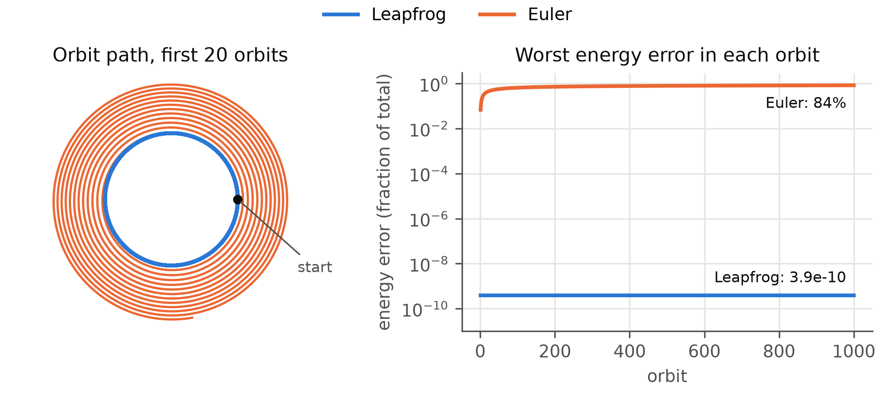

## Oct 22: OpenMP gravity (#42, #19)

One `#pragma omp parallel for` over particles, with `schedule(static)` and `default(none)`. Each thread writes only its own particles' accelerations, so there are no races and no atomics. At N = 10,000 it's 5.9 times faster on 6 threads (98% efficiency), and ThreadSanitizer with Archer finds no races. It does flag a deliberately racy test program, so we know the checker works.

What the thread counts showed: 8 threads is slower than 6, because static scheduling gives every thread the same amount of work and two cores end up running two threads each. 12 threads is no better than 6, since a core's two hardware threads share its floating-point units. An early "123% efficiency" result turned out to be clock-speed noise, so the benchmark now interleaves its runs.

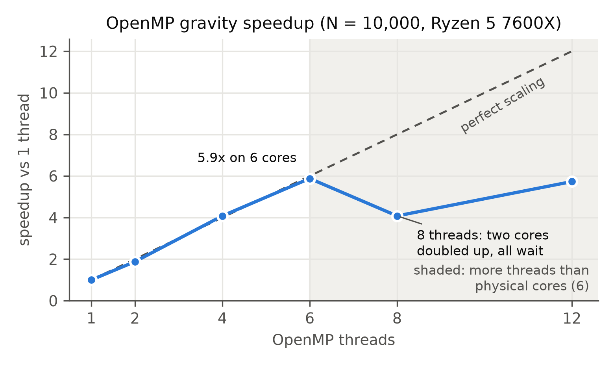

## Oct 27: The simulation program (#43, #14)

`planet_sim` runs built-in scenarios (two-body orbit, figure-eight, random cloud), has a benchmark mode, writes an energy log, and exits with code 2 if anything becomes NaN. First end-to-end OpenMP result: 5,000 particles at 0.077 s per step serial and 0.012 s with 6 threads (6.4 times faster).

## Oct 30: Project proposal (#44)

The proposal and its figures. The collision image below came from an early prototype, not from our C++ code.

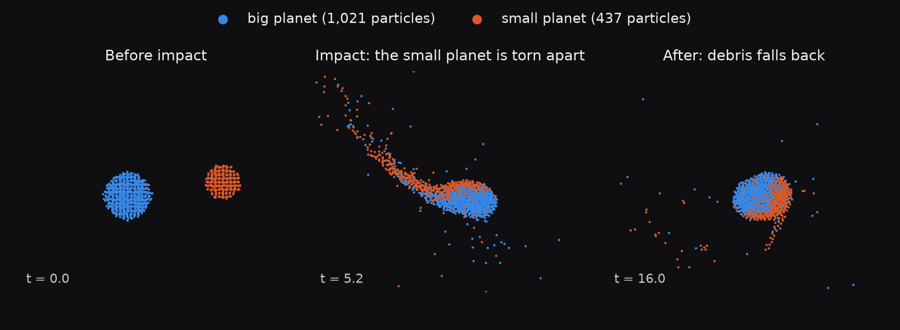

## Oct 30: First GPU backend (#51, #24, #25)

A HIP kernel with one GPU thread per particle, in double precision. HIP is an optional build, and CI compiles it in an AMD ROCm container (the CI machines have no GPU). It matches the serial results to 1e-12.

Compared with OpenMP for a whole step, the GPU is slower at 2,000 particles (0.6x), then 1.3 times faster at 10,000 and 2.1 times at 30,000. That's a modest gain, and the reason is precision: this card runs `double` about 13 times slower than `float`. Timing the kernel alone at N = 10,000 gave 25 ms in double and 2.0 ms in float. Small runs lose because launching the kernel and copying data cost more than the math saves.

Review also found a real bug. ROCm lists the CPU's built-in graphics as a second GPU, and if any visible GPU has no compiled code, the runtime aborts the kernel launch. We now build for both chips and pick the device by architecture.

## Oct 30: Live viewer (#52, #45, #48)

`planet_view` is a 3D window (raylib) that runs the same simulation as `planet_sim`. Keys 1, 2 and 3 switch between serial, OpenMP and the GPU while it runs, and the overlay shows ms per step and fps. CI runs it for 60 frames on a virtual screen.

Same 10,000-particle cloud, same moment, three backends:

| Serial: 277 ms/step, 4 fps | OpenMP (12 threads): 47 ms/step, 21 fps | GPU (double): 28 ms/step, 36 fps |
|---|---|---|
| 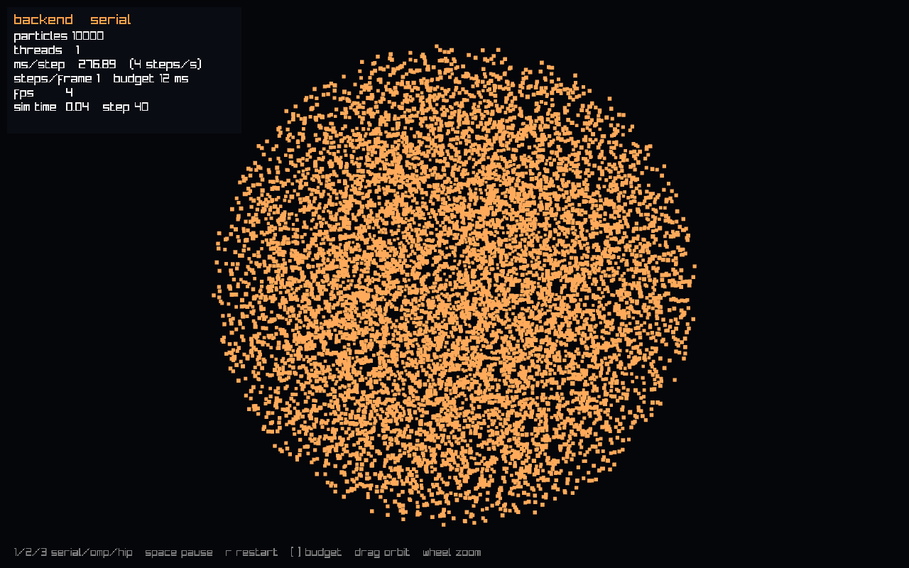 | 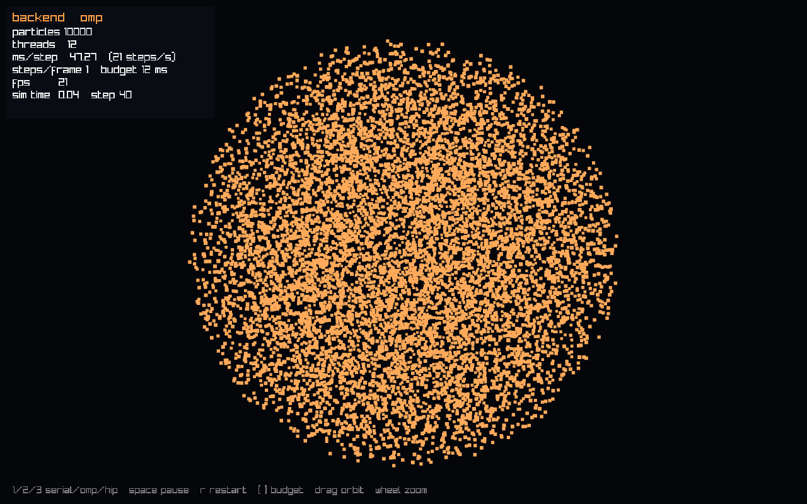 |  |

5,000 particles on the GPU at 60 fps, collapsing under their own gravity:

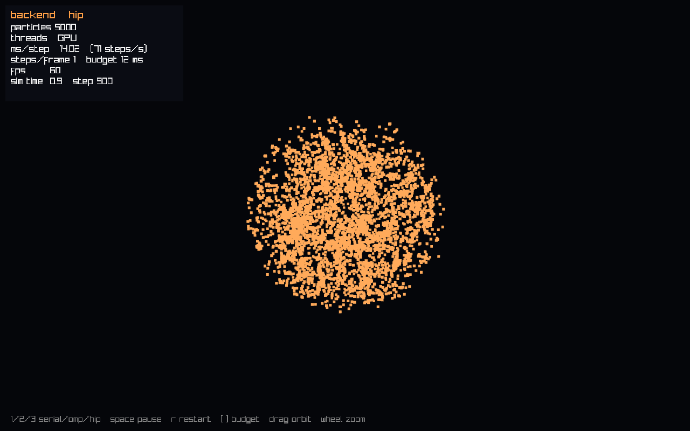

The GPU numbers here come from the first, simple kernel. The float and tiled kernels are next.

## Nov 2: Planet generation (#9)

`make_planet()` builds a planet as a ball of particles on a face-centered cubic lattice (the densest regular packing, like stacked oranges), centered on its center of mass, with a small random nudge per particle from a fixed seed. Generation runs once per planet before the simulation starts, so it stays serial.

Review caught a reproducibility bug that matters for comparing backends: the release build (`-march=native`) rounds floating-point math slightly differently, which made the same seed give a different planet in 1,003 of 2,000 particles. Picking lattice points by exact integer distance fixed it; the two builds now agree to 1e-16.

For 2,000 particles in a unit ball, particles can be up to about 0.0688 in radius before neighbors overlap by more than 10% of a particle radius; past that, `make_planet` stops with an error instead of building a planet that would blow apart on the first step. Nothing renders planets yet; the first pictures come with frame output (#10) and the render script (#11).

## Nov 2: Frame output (#10)

`planet_sim --out <dir>` now saves the particle positions every `--output-every` steps, one CSV file per frame (`frame_00000.csv`, `frame_00001.csv`, ...), next to the energy log. Each row is a particle id, its position and which planet it came from, written with enough digits to read back the exact same numbers. A frame is about 68 bytes per particle, so a 2,000-particle run writes 136 KB per frame. Writing happens on one thread between steps, so it costs time only on the steps that output a frame. The render script (#11) turns these into a video.

## Nov 3: Frames to video (#11)

`scripts/render.py frames/<run> -o run.mp4` turns a run's frames into an MP4, one image per frame, colored by planet. It's a quick-look tool for checking runs; the polished videos will come from the viewer (#49). The camera stays fixed for the whole video and ignores the few particles that fly far away, so the planets don't shrink to a dot. CI renders a short real run on every PR and uploads the video.

The first planets we can see: two generated planets of 2,000 particles each, moving toward each other. This still is `frame_00006.csv` (t = 0.6), from rendering the run's first 7 frames on their own, so the camera box fits the two planets instead of the whole 121-frame run:

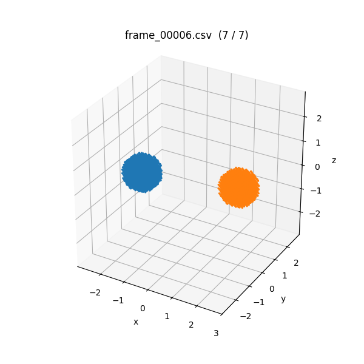

Contact forces don't exist yet (#12), so in the rest of this video both planets collapse under their own gravity and spray particles outward instead of colliding. That's the expected result without contact. M1 is done with this entry.

## Nov 5: Contact forces (#12)

Particles that overlap now push apart with a spring and lose energy through a damper. For an overlap `δ`, the force is `k·δ − c·v_n` along the line between the two centers, where `v_n` is the relative speed along that line (negative while they approach). This version checks every pair, so it is O(N²) like gravity. The uniform grid (#23) will check only nearby particles.

The loop has the same shape as the reference gravity: each particle adds up the pushes from all the others, so every pair is computed twice. That doubles the arithmetic, but the two sides see exactly negated inputs, so the pair forces cancel bit for bit. A parallel version can also give each thread its own particles, so no two threads ever write to the same particle.

The force is not clamped, so near the end of a damped contact the damper can briefly pull the two particles back together. In the bounce below that pull reaches about 28% of the peak push. This is the standard spring-dashpot model, and the formula that picks `c` for a target bounciness assumes it.

In a head-on bounce of two particles with gravity on, the energy after the bounce matches the energy before to within 1.2e-5 of the starting kinetic energy when there is no damping, and within 3e-6 at smaller timesteps. The error doesn't shrink smoothly as the step gets smaller, because it depends on where the steps land relative to the moment of first touch. With damping set for a restitution of 0.5, the bounce loses 88% of the starting kinetic energy, against 87.5% predicted. That is 75% of the kinetic energy at impact, which gravity raised on the way in. There is no video yet. Planets that hold their shape also need the relaxation phase (#15) and a scenario that turns contact on (#13).

## Nov 7: Scenario files (#13)

A run can now be described in a text file instead of code: `planet_sim --config configs/head_on.cfg`. Each line is `key = value`, and planets are numbered (`planet0.radius = 1.0`). A misspelled or repeated key, a bad number, a planet missing a required value, or a planet that can't be built (say, particles too big for it) stops the run with the file name, the line or planet, and the reason, so a typo can't quietly run the wrong simulation or crash it. Command-line flags like `--steps` still override the file.

There are two files. `head_on.cfg` has two planets of 2,000 particles, for the first collision video (#18). They start at half their escape speed, and gravity speeds them up to about 92% of it by the time they touch. `smoke.cfg` is a 500-particle version that collides within 200 steps, for the CI smoke test (#17).

The smoke run is a small example of when threads don't pay off. Its 200 steps take 0.18 s serial, 0.10 to 0.12 s with OpenMP on 4 threads, and 1.06 to 1.25 s on all 22 threads, about 6x slower than serial. With 500 particles, each of 22 threads gets about 23 particles per step, so starting and joining the threads every step costs more than the work they split. Only gravity is parallel so far, and contact still runs serially.

Running them showed a gap in the energy log. In the first 300 steps of the head-on run, kinetic plus gravitational energy rose twice, by 0.065 and 0.026. Adding the energy stored in compressed contact springs, computed from the frames, removes both rises: that total only falls, from -5.366 to -5.498. The planets aren't relaxed yet (#15), so they sag under their own gravity and spring back, and `energy.csv` doesn't count spring energy yet.

## Nov 18: Planet relaxation (#15)

Before the impact, each planet now settles on its own into a stable ball. The planet takes normal steps with every velocity slowed a little after each one, like moving through syrup, until it has stayed nearly still for about the time a particle needs to cross it. Stopping at the first quiet moment doesn't work: a fresh planet sags under its own gravity and bounces back, and it is briefly still at the bottom of every bounce.

The two head-on planets settle in about 866 steps each and shrink by 3%. This fixes the energy rises found with the scenario files. In the first 300 steps of the head-on run, kinetic plus gravitational energy used to jump by 0.065 and 0.026 as the unrelaxed planets bounced. Now the largest rise is 2e-6.

Relaxation is the same O(N²) force loop as the main run, so it costs real time: about a minute (53 s and 61 s in two runs) for the two 2,000-particle planets on 22 threads. On the small smoke planets, 22 threads are again much slower than serial, because each thread gets only about 11 particles.

## Nov 19: First collision video and energy plot (#18)

The head-on scenario (`configs/head_on.cfg`, two relaxed planets of 2,000 particles each) now runs from start to finish. The planets fall toward each other, touch at about t = 2.4, and merge into one body that is nearly at rest by t = 10. The video isn't committed; it is linked in the PR. The left still is from rendering frames 0 to 52 on their own, the right one is the last frame of the full video:

| t = 2.6, just after contact | t = 10, merged |
|---|---|
| 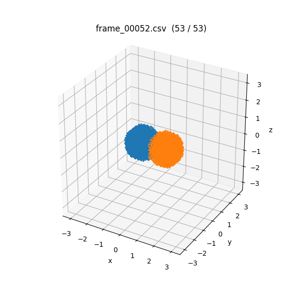 | 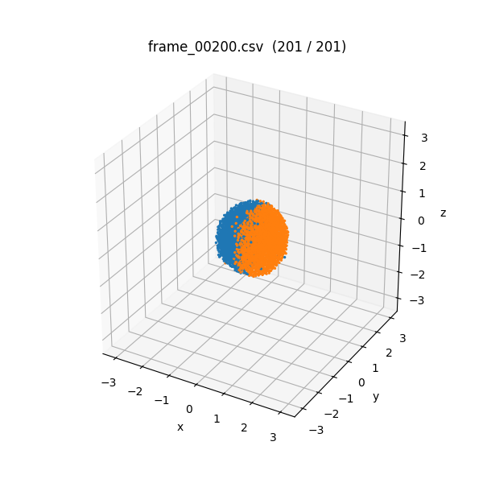 |

`scripts/plot_energy.py` turns a run's `energy.csv` into the plot below and prints the total change and the largest rise of the total between two rows of the log. Gravity speeds the planets up from a kinetic energy of 0.5 to 1.89 at contact. After that the logged total falls by 2.52, which is 46% of the starting total of -5.53, as the contact dampers turn motion into heat, and the merged body ends with a kinetic energy of 0.0013.

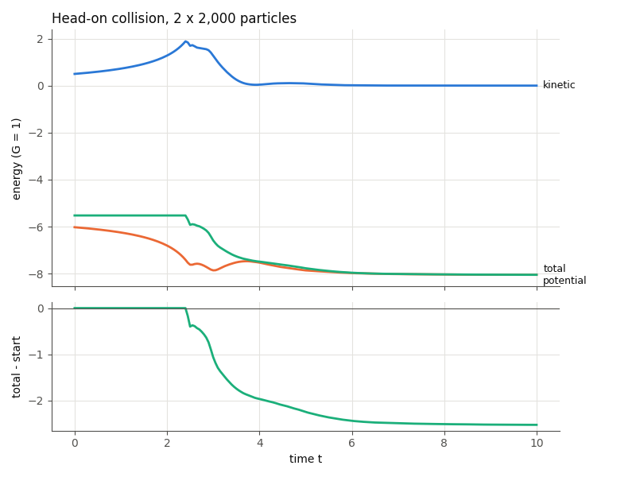

The logged total does rise once, by 0.028 between steps 1250 and 1275, as the two planets push back off each other. This is the gap in the log found with the scenario files: `energy.csv` doesn't count the energy held in compressed contact springs. Computed from the frames, the springs held 0.33 at step 1250 and 0.12 at step 1275. With that energy added, the total never rises by more than 5e-7 between any two of the 201 frames, and those tiny rises all come before contact. Adding spring energy to the log is #59.

The run took 444 s for 5,000 steps (0.089 s per step) on 22 threads with the dev build, plus about a minute of relaxation, and rendering its 201 frames took 26 s. Gravity runs on all threads, but contact is still the serial all-pairs version, so this time is not a scaling result. The contact grid (#23) comes next.

## Nov 19: Contact heat (#46)

The energy the contact dampers remove now goes somewhere: each particle stores it as heat. When two particles are pressed together and moving, the damper's power is split half to each, and the energy log has a new `heat` column. Its `total` is now kinetic + potential + heat, so instead of falling during a collision it should stay flat, which is a much stronger check than "never rises". The heat will also drive the white-hot impact coloring in the viewer (#47).

The same head-on run as above, now with heat. The motion is exactly the same; only the bookkeeping changed. Heat (yellow) climbs to 2.48 while kinetic energy drops, and the total goes from -5.53 to -5.57 instead of to -8.05. The dip of 0.33 at t = 2.5 is the energy held in compressed contact springs, which the log doesn't count yet (#59):

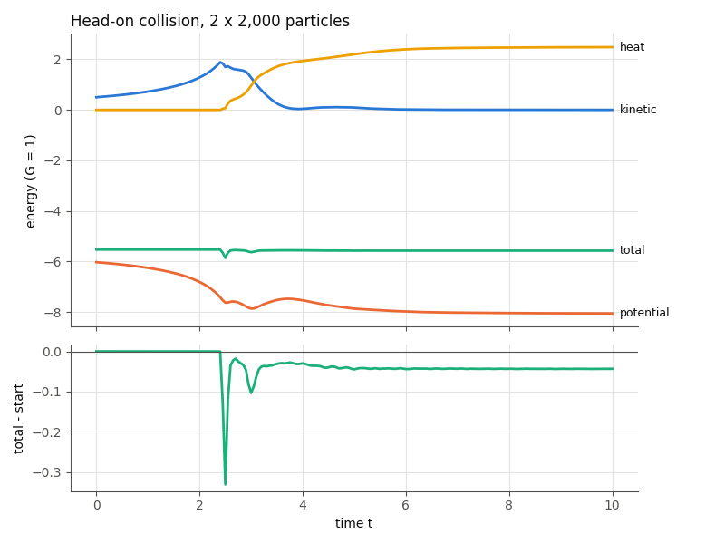

Getting the heat right took one correction. The damper's strength is computed from the velocities halfway through a step, but by the time it has acted, those velocities have already shrunk. Booking the plain `c·vn²·dt` counted about 10% too much heat at the head-on settings. Multiplying by `1 − c·dt/(2·m_eff)` fixes that: in a two-particle bounce, kinetic + potential + heat afterwards matches the start to 1e-5 of the starting kinetic energy, against 2.7e-3 without it. In the head-on run, heat accounts for 98.7% of the energy the dampers removed.

For the parallel versions of contact (#23, #27), each particle's heating rate is written only by the loop iteration that handles that particle, so threads can split the particles without ever writing to the same memory, the same way as for the forces.
