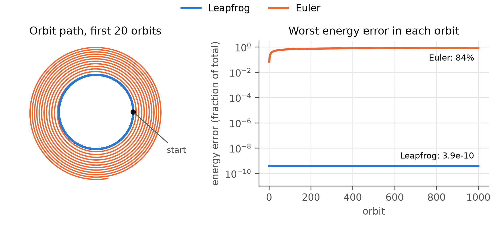
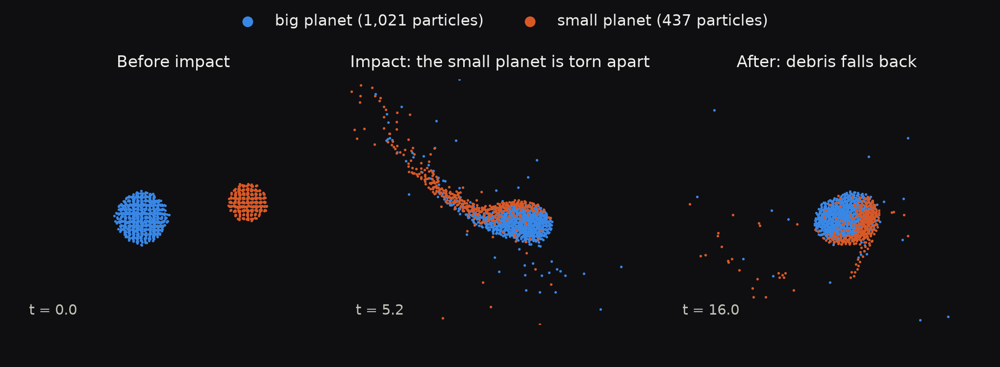
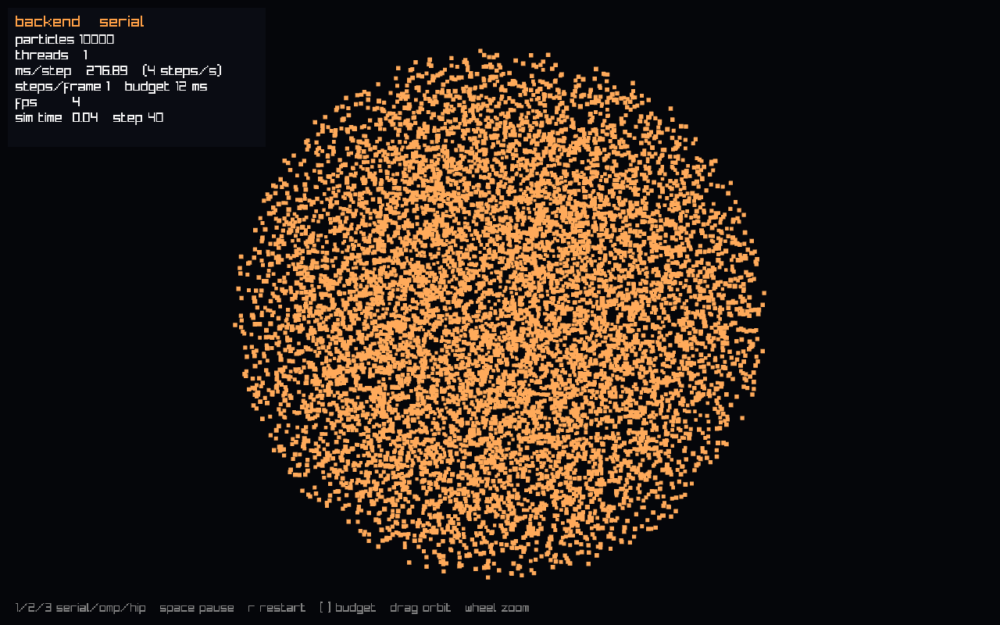
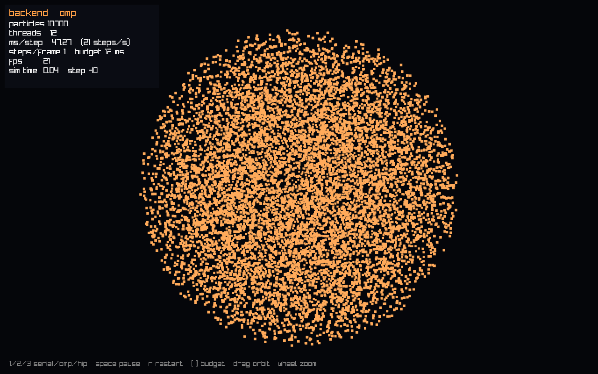
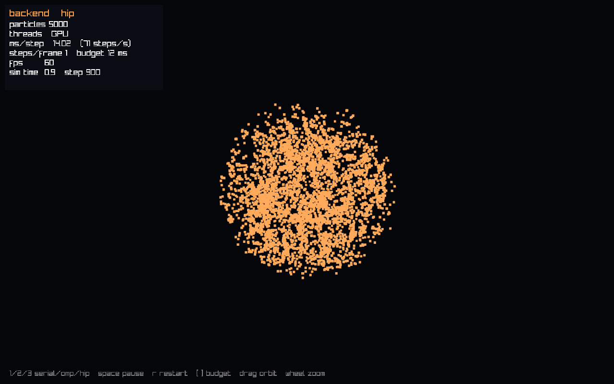

# Progress log

What we built and when, what each step taught us about parallel computing, and the numbers behind it. Full design reasoning and measurements are in [notes.md](notes.md). Each PR that changes what the simulator can do or measure adds an entry here, with a screenshot (in [media/](media/)) or a plot (in [figures/](figures/)) when there's something to see.

Hardware for every number below: AMD Ryzen 5 7600X (6 cores, 12 threads), AMD Radeon RX 9060 XT (`gfx1200`), Arch Linux, ROCm 7.2.4.

## Goal

Two planets made of particles collide. The same O(N²) gravity runs on three backends (serial, OpenMP, HIP on the GPU), and the live viewer lets you switch between them mid-collision. Before building the viewer we picked its look with a quick browser prototype running a JavaScript port of the same physics.

Still to do: planets, contact forces and relaxation (#9, #12, #15), faster GPU kernels (#32 float, #26 tiling, #30 keeping data on the GPU), the glow look (#47), recorded runs to video (#49) and the full scaling plots (#34).

## Oct 22: Build, CI and test setup (#1, #39, #40)

CMake presets, GoogleTest, and CI on every pull request: gcc and clang, AddressSanitizer, and ThreadSanitizer. Particles are stored as separate arrays per field (struct of arrays), so the force loop reads contiguous memory on the CPU and gets coalesced loads on the GPU.

We set up the testing rules before writing any parallel code, because parallel bugs often produce output that looks fine. Every backend is compared against one serial reference with relative tolerances, at 1 and 4 threads, and under ThreadSanitizer. We also switched the GPU plan from CUDA to HIP because our GPU is an AMD card. HIP code is almost identical to CUDA.

## Oct 22: Serial reference gravity (#41, #7)

All-pairs gravity in `gravity_serial.cpp`. It's the reference the other backends are checked against, so it is never optimized. It matches hand-computed 2- and 3-body forces to 1e-14, and the tests caught all 19 broken versions we tried on purpose.

## Oct 22: Leapfrog instead of Euler (#8)

Leapfrog costs the same as Euler (one force evaluation per step) but doesn't drift. Over 1,000 orbits its energy error stays at 3.9e-10, while Euler's orbit spirals out to 6 times its starting radius.

## Oct 22: OpenMP gravity (#42, #19)

One `#pragma omp parallel for` over particles, with `schedule(static)` and `default(none)`. Each thread writes only its own particles' accelerations, so there are no races and no atomics. At N = 10,000 it's 5.9 times faster on 6 threads (98% efficiency), and ThreadSanitizer with Archer finds no races. It does flag a deliberately racy test program, so we know the checker works.

What the thread counts showed: 8 threads is slower than 6, because static scheduling gives every thread the same amount of work and two cores end up running two threads each. 12 threads is no better than 6, since a core's two hardware threads share its floating-point units. An early "123% efficiency" result turned out to be clock-speed noise, so the benchmark now interleaves its runs.

## Oct 27: The simulation program (#43, #14)

`planet_sim` runs built-in scenarios (two-body orbit, figure-eight, random cloud), has a benchmark mode, writes an energy log, and exits with code 2 if anything becomes NaN. First end-to-end OpenMP result: 5,000 particles at 0.077 s per step serial and 0.012 s with 6 threads (6.4 times faster).

## Oct 30: Project proposal (#44)

The proposal and its figures. The collision image below came from an early prototype, not from our C++ code.

## Oct 30: First GPU backend (#51, #24, #25)

A HIP kernel with one GPU thread per particle, in double precision. HIP is an optional build, and CI compiles it in an AMD ROCm container (the CI machines have no GPU). It matches the serial results to 1e-12.

Compared with OpenMP for a whole step, the GPU is slower at 2,000 particles (0.6x), then 1.3 times faster at 10,000 and 2.1 times at 30,000. That's a modest gain, and the reason is precision: this card runs `double` about 13 times slower than `float`. Timing the kernel alone at N = 10,000 gave 25 ms in double and 2.0 ms in float. Small runs lose because launching the kernel and copying data cost more than the math saves.

Review also found a real bug. ROCm lists the CPU's built-in graphics as a second GPU, and if any visible GPU has no compiled code, the runtime aborts the kernel launch. We now build for both chips and pick the device by architecture.

## Oct 30: Live viewer (#52, #45, #48)

`planet_view` is a 3D window (raylib) that runs the same simulation as `planet_sim`. Keys 1, 2 and 3 switch between serial, OpenMP and the GPU while it runs, and the overlay shows ms per step and fps. CI runs it for 60 frames on a virtual screen.

Same 10,000-particle cloud, same moment, three backends:

| Serial: 277 ms/step, 4 fps | OpenMP (12 threads): 47 ms/step, 21 fps | GPU (double): 28 ms/step, 36 fps |
|---|---|---|
|  |  |  |

5,000 particles on the GPU at 60 fps, collapsing under their own gravity:

The GPU numbers here come from the first, simple kernel. The float and tiled kernels are next.
